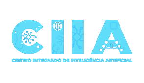
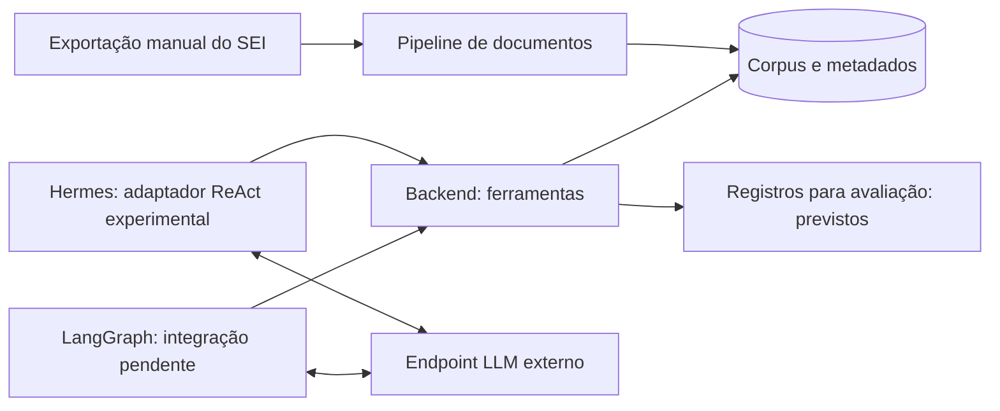

<p align="center">
  
</p>

<h1 align="center">Benchmark SEI: Hermes × LangGraph</h1>

<p align="center">
  Comparação experimental de agentes sobre documentos administrativos exportados do SEI<br>
  <strong>CIIA · NIAUnDF — Universidade do Distrito Federal (UnDF)</strong>
</p>

<p align="center">
  
  
  
  
  
  
</p>

---

## Sobre o projeto

Este repositório compara duas implementações de agentes, **Hermes** e **LangGraph**, executadas sobre o **mesmo corpus**, as **mesmas ferramentas HTTP** e o **mesmo modelo de linguagem**. A pergunta de pesquisa:

> Com corpus, ferramentas, modelo e orçamento comparáveis, como as duas implementações diferem em **sucesso verificável**, **fundamentação**, **latência**, **uso de ferramentas** e **custo**?

Os documentos vêm de **exportações manuais do SEI**. Toda consulta e futura escrita acontece no ambiente experimental; **não existe conexão com o SEI real**. Prazo final planejado: **10/12/2026**.

## Início rápido

Pré-requisitos: [Git](https://git-scm.com/) e [uv](https://docs.astral.sh/uv/getting-started/installation/). Na raiz do repositório:

```sh
uv sync --locked                              # instala o ambiente travado (Python 3.12)
uv run --locked python -m scripts.dev demo    # ingestão + consultas, sem chave de LLM
uv run --locked python -m scripts.dev check   # ruff, formato, validador e pytest
```

A demo importa um documento fictício, gera chunks, persiste em SQLite e consulta a API em processo. Funciona também no PowerShell. Com Make: `make setup`, `make demo`, `make check`.

| Comando (`uv run --locked python -m scripts.dev …`) | O que faz |
| --- | --- |
| `demo` | Demonstração local com SQLite |
| `check` | Verificação completa (igual à CI `quality`) |
| `test-backend` · `test-documents` · `test-integration` | Testes dirigidos por frente |
| `serve` | API em `127.0.0.1:8000` (OpenAPI em `/docs`) |
| `up` · `down` · `demo-compose` | Stack com PostgreSQL via Docker Compose (exige `.env`) |

Para HTTP e Compose, veja o [início rápido detalhado](docs/00-comece-aqui/01-inicio-rapido.md).

## Arquitetura



- **O agente seleciona as ferramentas; o backend valida e executa.** Os adaptadores usam apenas o `ToolClient` e nunca acessam o banco.
- A ingestão acontece antes das tarefas. Chunks de 140 caracteres com sobreposição de 20, sem atravessar páginas e com IDs determinísticos.
- A busca atual é por **substring literal**, filtrada por processo e corpus, com limite de 20 resultados. Resultado vazio **não prova** ausência no processo original.

Detalhes em [arquitetura](docs/02-arquitetura/architecture.md) e [contratos v0.1](contracts/README.md).

### Ferramentas compartilhadas

| Ferramenta | Estado |
| --- | --- |
| `consultar_processo` | ✅ Implementada |
| `buscar_documentos` | ✅ Implementada (substring literal) |
| `ler_documento` | ✅ Implementada |
| `consultar_requisitos` | 📝 Contrato definido, responde HTTP 501 |
| `registrar_pendencia` | 📝 Contrato definido, responde HTTP 501 |
| `salvar_minuta` | 📝 Contrato definido, responde HTTP 501 |

## Estrutura e equipes

| Pasta | Conteúdo | Equipe |
| --- | --- | --- |
| [pipelines/documents](pipelines/documents/README.md) | Extração, qualidade, chunking, metadados e recuperação | Documentos |
| [services/backend](services/backend/README.md) | API, persistência e ferramentas | Backend |
| [agents/hermes](agents/hermes/README.md) | Adaptador Hermes (versão a confirmar) | Hermes |
| [agents/langgraph](agents/langgraph/README.md) | Grafo de estado e ciclo modelo–ferramenta | LangGraph |
| [infra](infra/README.md) | Compose, persistência, configuração e operação | Infraestrutura |
| [evaluation](evaluation/README.md) | Protocolo, tarefas, rubricas e métricas | Metodologia |
| [portal](portal/README.md) | Portal de documentação (Next.js) | Portal |
| [contracts](contracts/README.md) | Interfaces v0.1 compartilhadas | Revisão conjunta |
| [scripts](scripts/README.md) · [tests](tests/README.md) | Comandos de desenvolvimento e verificações | Todas |
| [examples](examples/README.md) | Dados exclusivamente fictícios | Documentos |
| [docs](docs/README.md) | Guias, decisões, operação e PDFs históricos | Coordenação |

Coordenação: André Vital, Gustavo Antônio, João Enomoto e Roger Quinelato. Pessoas e responsabilidades em [guias das equipes](docs/00-comece-aqui/04-equipes.md).

## Metodologia

O [protocolo](evaluation/protocol.md) ainda é **proposta, não aprovada para coleta**. Princípios:

- **Paridade:** mesmas tarefas, snapshots, ferramentas, modelo e orçamento para os dois executores.
- **Sem roteiro fixo:** nenhum adaptador pode codificar a sequência de ferramentas que resolve uma tarefa.
- **Conjuntos separados:** tarefas sintéticas para desenvolvimento; as finais ficam reservadas fora do Git.
- **Congelamento:** corpus, commits, `uv.lock`, versões, prompts e modelo são fixados antes das rodadas finais.
- **Sucesso verificado:** escrita só conta após conferência independente; tokens/custo ausentes ficam `null`.

Há também uma [proposta de benchmark em duas camadas](docs/02-arquitetura/proposta-benchmark-duas-camadas.md), ainda em revisão pela coordenação.

## Estado atual

**Implementado:** corpus sintético paginado, chunks rastreáveis, ingestão transacional, consulta de processo, busca textual filtrada e leitura de documento; testes e comandos locais. Compose e CI estão preparados para PostgreSQL.

**Pendente:** PDF/OCR, recuperação semântica, requisitos validados, ferramentas de escrita, autenticação, migrações, persistência de `ExperimentRun`, agentes reais, coleta experimental e implantação. O repositório e a versão do Hermes ainda precisam ser confirmados.

> [!IMPORTANT]
> **Ainda não há resultados comparativos.** Os [PDFs originais](docs/README.md) são propostas históricas e não comprovam marcos, implantação nem preços atuais. Veja [status e evidências](docs/01-overview/project-status.md) e o [backlog](docs/01-overview/backlog.md).

## Contribuir

1. Trabalhe na branch da sua equipe (`team/*`), opcionalmente em branches curtas `task/<equipe>-<assunto>`.
2. Antes de começar e antes do PR, incorpore `origin/main` **manualmente, por merge**.
3. Abra PR `team/* → main`. A promoção `main → production` é aprovada pela coordenação.
4. Use **merge commits**. Não use force push, rebase ou squash nas branches permanentes.

Leia [CONTRIBUTING](CONTRIBUTING.md), o [fluxo Git](docs/00-comece-aqui/02-fluxo-git.md) e a [governança](docs/04-operacoes/github-governance.md). Para desenvolvimento assistido por IA, veja [AGENTS.md](AGENTS.md), [GEMINI.md](GEMINI.md) e o [guia de IA](docs/02-arquitetura/ai-development.md).

> [!CAUTION]
> Nunca versione documentos reais, dados pessoais, `.env`, backups ou credenciais. A API não tem autenticação e deve receber apenas dados sintéticos em loopback ou rede interna.

---

<p align="center"><sub>CIIA · NIAUnDF — Universidade do Distrito Federal · Projeto experimental de pesquisa</sub></p>
