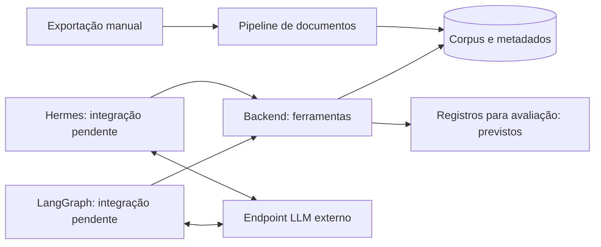

# Projeto Hermes — comparação de agentes sobre documentos administrativos

Centro de Inovação em Inteligência Artificial (CIIA) — Universidade do Distrito Federal (UnDF).

Comparamos implementações Hermes e LangGraph utilizando o mesmo corpus, ferramentas e modelo de linguagem. A pergunta é como diferem em conclusão de tarefas, fundamentação, latência e custo. Os documentos são exportados manualmente do SEI; toda consulta e futura escrita ocorre no ambiente experimental. Não existe conexão com o SEI real.

## Comece por aqui

Instale Git e [uv](https://docs.astral.sh/uv/getting-started/installation/). Na raiz:

```sh
uv sync --locked
uv run --locked python -m scripts.dev demo
uv run --locked python -m scripts.dev check
```

Também funciona no PowerShell. A demo importa documento fictício, gera chunks, persiste em SQLite e consulta a API em processo, sem chave de LLM. Para HTTP e PostgreSQL/Compose, veja [início rápido](docs/00-comece-aqui/01-inicio-rapido.md). Com Make: `make setup`, `make demo`, `make check`.

## Arquitetura



Os agentes selecionam ferramentas; o backend valida e executa operações autorizadas. A VPS Hostinger hospedará serviços; não se presume GPU ou assinatura de LLM. [Arquitetura](docs/02-arquitetura/architecture.md).

## Onde trabalhar

| Pasta | Conteúdo / equipe |
| --- | --- |
| [pipelines/documents](pipelines/documents/README.md) | Extração, qualidade, chunking, metadados e recuperação — Documentos (3) |
| [services/backend](services/backend/README.md) | API, persistência e ferramentas — Backend (3) |
| [agents/hermes](agents/hermes/README.md) | Integração do Hermes a confirmar — Hermes (2) |
| [agents/langgraph](agents/langgraph/README.md) | Estado e ciclo modelo–ferramenta previstos — LangGraph (2) |
| [infra](infra/README.md) | Compose, persistência, configuração e operação — Infraestrutura (2) |
| [evaluation](evaluation/README.md) | Tarefas, rubricas e métricas antes da coleta — Metodologia (2) |
| [contracts](contracts/README.md) | Interfaces v0.1 compartilhadas |
| [scripts](scripts/README.md) / [tests](tests/README.md) | Comandos de desenvolvimento e verificações |
| [examples](examples/README.md) | Dados exclusivamente fictícios |
| [docs](docs/README.md) | Guias, decisões, runbooks e PDFs históricos |
| [.github](.github/README.md) | CI, templates e mapa de revisão |

Coordenação: André / Gustavo / João Enomoto. Preencha responsáveis nos [guias das equipes](docs/00-comece-aqui/04-equipes.md). A proposta soma 14 vagas técnicas; participação e sobreposição da coordenação precisam ser confirmadas para o total aproximado de 15 pessoas.

## Contribuir

Trabalhe na branch da equipe, opcionalmente usando branches curtas integradas primeiro nela. Abra PR `team/* → main`; após integração, a coordenação aprova PR `main → production`. Use **merge commits**, sem force push e sem excluir branches permanentes. `production` é a versão estável experimental. Antes de iniciar tarefas e antes de integrar entregas, cada equipe coordena a incorporação manual da `main`. Atualizações da `main` não abrem PRs nem modificam as branches das equipes automaticamente. Merge e implantação na Hostinger são etapas distintas. Leia [CONTRIBUTING](CONTRIBUTING.md) e [fluxo Git](docs/00-comece-aqui/02-fluxo-git.md).

## Estado atual

Implementados: corpus sintético paginado, chunks rastreáveis, persistência transacional, consulta de processo, busca textual filtrada e leitura de documento; testes e comandos locais. Compose e CI estão preparados para PostgreSQL.

Pendentes: PDF/OCR, recuperação semântica, requisitos validados, ferramentas de escrita, autenticação para uso compartilhado, agentes reais, coleta experimental e implantação. Os pontos de entrada dos agentes exercitam somente HTTP. O Hermes exato precisa de URL e versão. Não há resultados comparativos coletados.

O fluxo Git exige branches, revisão humana e checks obrigatórios. Veja [status e evidências](docs/01-overview/project-status.md), [governança](docs/04-operacoes/github-governance.md), [backlog](docs/01-overview/backlog.md) e [Codex/Claude Code](docs/02-arquitetura/ai-development.md).

Prazo final planejado: **10/12/2026**. Os [PDFs originais](docs/README.md) permanecem como propostas históricas; não comprovam conclusão de marcos, implantação ou preços atuais.
