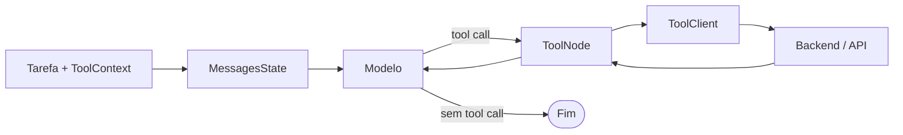

# LangGraph

Grafo experimental para comparação com o Hermes. A tarefa entra no estado, o
modelo decide se precisa de uma ferramenta e o resultado retorna para nova
decisão ou encerramento.

Implementado: `StateGraph`, `MessagesState`, `ToolNode`, arestas condicionais,
seis ferramentas via `ToolClient`, contexto experimental e testes do ciclo.

Planejado: modelo real, `AgentAdapter`, checkpoints, limites operacionais,
tratamento de exceções e persistência de `ExperimentRun`.

Código: [`graph.py`](graph.py). Smoke HTTP:
`uv run --locked python -m agents.smoke --adapter langgraph`.
