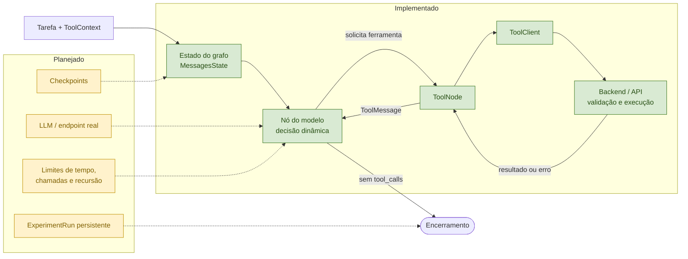

# LangGraph — grafo inicial

## Resumo

A base do agente LangGraph já possui um ciclo dinâmico modelo → ferramenta →
modelo, com contexto experimental repassado ao Backend e testes do fluxo
principal. A integração com modelo real, checkpoints, limites operacionais e
`ExperimentRun` permanece pendente.

## Arquitetura visual

O fluxo entra pelo estado, passa pelo modelo e só executa ferramentas quando
o modelo as solicita. O resultado volta ao estado para uma nova decisão ou
encerra o grafo quando não há `tool_calls`.

Implementado: `StateGraph`, `MessagesState`, nó de modelo, `ToolNode`, arestas
condicionais, seis ferramentas via `ToolClient`, propagação do contexto e
testes do ciclo principal.

Planejado: modelo/endpoint real, `AgentAdapter`, cliente HTTP assíncrono,
checkpoints, limites operacionais, tratamento estruturado de exceções e
persistência de `ExperimentRun`.

O projeto fixa `langgraph>=1.2,<2` no lockfile. A integração usa a Graph API
(`StateGraph`, `MessagesState`, `ToolNode` e arestas condicionais); a versão do
provedor/modelo de inferência continua pendente. A interface comum está em
[AgentAdapter/ToolClient](../interface.py).

Ciclo previsto: tarefa e estado chegam ao modelo; o modelo pode solicitar uma ou mais ferramentas; o adaptador valida o nome e envia a chamada ao backend; o resultado/erro retorna ao estado e ao modelo; o próximo passo pode ser outra chamada ou encerramento. Limites de chamadas, tempo e tokens devem interromper execução com motivo registrado.

O grafo está em [`graph.py`](graph.py). O estado registra tarefa, mensagens,
contagem de chamadas ao modelo e ferramentas. O modelo decide dinamicamente se
solicita uma ferramenta; o `ToolNode` encaminha a chamada ao backend; a aresta
condicional encerra quando não há `tool_calls`. O grafo não acessa banco nem
implementa regras de negócio.

Ainda não estão incluídos checkpoints, limites operacionais, cliente HTTP
assíncrono, `AgentAdapter` real, inferência externa ou persistência de
`ExperimentRun`; são etapas posteriores.

Com API populada em execução: `uv run --locked python -m agents.smoke --adapter langgraph`. Isso testa apenas HTTP. [Guia da equipe](../../docs/03-equipes/langgraph.md) e [quickstart oficial consultado](https://docs.langchain.com/oss/python/langgraph/quickstart).
