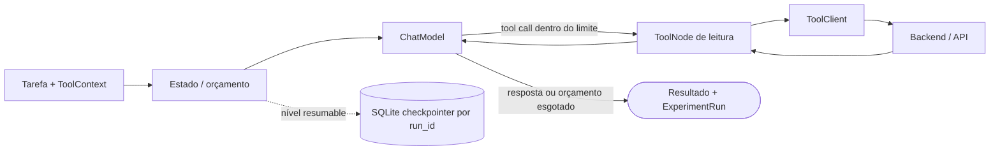

# LangGraph

Executor experimental para comparar níveis de apoio de IA em tarefas
administrativas de consulta ao SEI. O escopo é somente leitura: consultar
metadados do processo, buscar trechos e ler documentos. Consulta a requisitos,
registro de pendências e salvamento de minutas continuam fora do agente porque
essas operações ainda não estão implementadas no backend.

## Níveis executáveis

Os níveis usam a mesma tarefa, corpus, ferramentas e orçamento comparável entre
executores.

| Nível | Comportamento | Limite padrão |
| --- | --- | --- |
| `assisted` | Uma consulta ao backend; o modelo sintetiza o resultado. | 1 chamada de ferramenta; até 2 chamadas ao modelo. |
| `chained` | O modelo escolhe e encadeia operações de leitura durante uma tarefa. | Até 8 chamadas de ferramenta e 12 ao modelo. |
| `resumable` | O ciclo encadeado retoma mensagens, contadores, métricas e orçamento pela mesma execução. | Até 8 chamadas de ferramenta e 12 ao modelo; checkpointer obrigatório. |

Todos aceitam `ExecutionLimits` para reduzir os tetos e ajustar a duração total.
O limite de duração é cooperativo entre etapas do grafo; timeout dos clientes de
modelo e backend também precisa ser configurado para limitar chamadas em curso.
O nível 1 bloqueia ferramentas além da primeira antes de enviá-las ao backend.

## Checkpoint e retomada

`agents.langgraph.persistence.open_persistent_checkpointer()` abre o saver SQLite
por padrão em `data/langgraph-checkpoints.sqlite`; `LANGGRAPH_CHECKPOINT_PATH`
permite mudar o caminho. O serializer usa allowlist restrita. O mesmo
`ToolContext.run_id` define o `thread_id`; uma nova execução usa um UUID novo.

```python
from agents.langgraph.persistence import open_persistent_checkpointer
from agents.langgraph.adapter import LangGraphAdapter

with open_persistent_checkpointer() as checkpointer:
    adapter = LangGraphAdapter(..., level="resumable", checkpointer=checkpointer)
    result = adapter.run_with_result(task, context)
    # Após uma interrupção ou nova etapa da mesma tarefa:
    resumed = adapter.continue_run(follow_up_task, context)
```

Checkpoints guardam mensagens e resultados das ferramentas, que podem conter
texto documental. Até haver controles de acesso e retenção apropriados, use
somente os dados sintéticos de desenvolvimento. SQLite local é adequado para
teste e execução leve, não para múltiplos workers concorrentes.

## Adaptador e registros

`LangGraphAdapter` implementa `AgentAdapter`; recebe um ChatModel configurado
por injeção, usa `ToolClient` para o backend e persiste o contrato
`ExperimentRun` via `ExperimentRunClient`. `from_environment()` carrega
`LLM_BASE_URL`, `LLM_MODEL`, `LLM_API_KEY` e `LLM_TIMEOUT_SECONDS`, mas requer
uma fábrica específica do provedor. O projeto não presume endpoint, versão,
compatibilidade de tool calling nem credenciais. O ID do endpoint usado na
metodologia é um rótulo seguro informado em `RunMetadata`, sem URL ou chave.

O adaptador registra limites, status, latência, contagem de tokens quando o
modelo os reporta e metadados de chamadas sem guardar seus argumentos ou
respostas. Conteúdo final é devolvido ao harness e não armazenado no registro.
`agent_declared_success` significa apenas que o fluxo terminou com resposta;
`verified_success` permanece nulo até avaliação independente. Repetições da
mesma execução geram revisões sequenciais do registro.

## Fluxo



Smoke HTTP (não executa modelo):
`uv run --locked python -m agents.smoke --adapter langgraph`. O endpoint do
modelo, sua fábrica concreta e equivalência funcional com Hermes precisam de
validação antes da coleta. O histórico de execuções fica disponível em
`/experiments/{run_id}` e `/experiments/{run_id}/revisions`.
