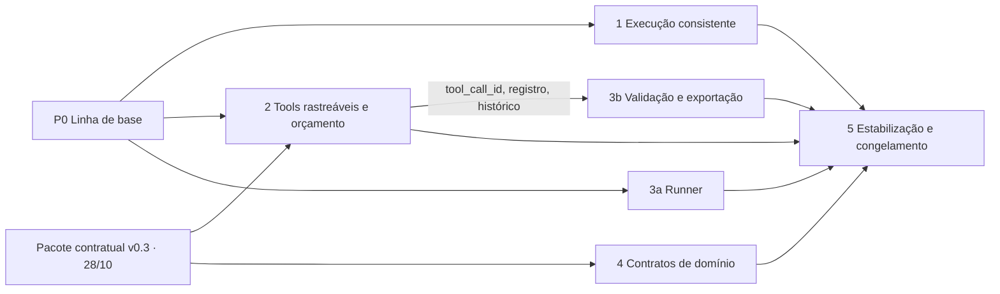

# Plano de implementação por blocos — Backend & Tools

Data: 25/10/2026. Responsável: Backend & Tools. Estado: proposta para aprovação, bloco a bloco.
Substitui a versão anterior deste arquivo, que estava organizada por defeito.
Fontes: guia do projeto de 17/09/2026 (cópia recebida com SHA-256 `5e2b1e0a…a846`, a mesma
citada no PRD; as seções técnicas coincidem com o [guia arquivado](../06-arquivo/Guia_Projeto_SEI_Hermes_LangGraph.pdf)),
[PRD](backend-prd.md), [TDD](backend-tdd.md), [protocolo](../../evaluation/protocol.md),
[auditoria de 24/10](../04-operacoes/auditoria-backend-2026-10-24.md) e
[correções de 25/10](../04-operacoes/correcoes-streaming-worker-2026-10-25.md).

## 1. Princípios

- Cada bloco entrega uma capacidade que pode ser demonstrada. Os defeitos da auditoria
  aparecem como critérios de cobertura do bloco que altera o componente afetado.
- Interfaces compartilhadas (seção 4) são definidas uma vez, antes dos blocos. Assim, a
  instrumentação de chamadas de tool é implementada uma única vez e reaproveitada pelo
  orçamento, pela validação do benchmark e pela exportação.
- Mudanças de contrato entre equipes formam um único pacote (v0.3), proposto até 28/10,
  publicado uma só vez e com uma só regeneração do OpenAPI.
- O que já funciona é preservado. A04 (503 no claim) e A07 (OpenAPI de erros) estão
  corrigidos e têm testes (`tests/backend/test_worker_polling.py`,
  `tests/backend/test_openapi.py`); não são refeitos.

## 2. Linha de base em 25/10

**Coberto e verificado**: seis tools REST; contexto da execução vindo do worker autenticado;
escritas com transação, constraint única, replay e conflito; evidência resolvida no
servidor, inclusive por inventário; aviso de exportação parcial; busca vazia distinta de
falha de infraestrutura; PostgreSQL, SQLAlchemy e Alembic (0001–0003); fila no PostgreSQL com
reserva; healthcheck; OpenAPI exportado e testado; tradução dos erros das tools no cliente
(corrigíveis voltam ao agente como `{"error": …}`; definitivos lançam `ToolCallError`);
chat com memória. Suíte: 50 testes aprovados em SQLite, lint e validador de links aprovados.

**Defeitos abertos**: A01, A02 e A03 foram reproduzidos de novo em 25/10 com
`data/audit_cto_probes.py`. A05, A06 e A08 foram confirmados pela leitura do código.

**Estado do Git**: a implementação v0.2 inteira e as mudanças de 25/10 estão sem commit
(86 entradas em `git status`). A branch está 6 commits à frente de `origin/team/backend`.
Outra conversa usa a mesma worktree. Worktrees de agentes paralelos só enxergam o que já foi
commitado, o que torna o pré-requisito P0 obrigatório.

## 3. Visão geral

| Bloco | Capacidade entregue | Esforço | Prazo | Depende de |
| --- | --- | --- | --- | --- |
| P0 — Linha de base | Base comum commitada e verde para todos os blocos | Baixo | 26/10 | Aprovação D1 |
| 1 — Execução e acompanhamento consistentes | Reconexão sem perda; conversa coerente; falhas explicadas | Médio | 30/10 (backend) / 06/11 (portal) | P0 |
| 2 — Chamadas de tools rastreáveis e com orçamento | Cada tentativa registrada e correlacionada; orçamento imposto; retentativa segura | Alto | 30/10 | P0; D2/D3 para o contrato |
| 3 — Benchmark ponta a ponta | Rodada aleatorizada, relatório validado, exportação para Avaliação | Médio | 30/10 (validação e exportação) / 06/11 (runner) | P0; interfaces do 2 para parte do trabalho |
| 4 — Contratos de domínio das tools | Filtros, metadados, checklist validado, referência de acesso | Baixo a médio | 30/10, se aprovado | Aprovações D4–D6 |
| 5 — Estabilização e congelamento | Versão reproduzível em PostgreSQL, documentação coerente, manifesto | Médio | 06/11 | 1–3 (e 4) |

Podem correr em paralelo: 1 ∥ 2 ∥ 3a, mais 4 depois das aprovações. A parte 3b é escrita
contra as interfaces I2/I4 e integrada quando o bloco 2 entrar. O item 5(a) (A08) pode ser
feito a qualquer momento.

**Por que estes blocos e não os quatro sugeridos.** "Tools, APIs e contratos" foi dividido em
dois. A instrumentação (bloco 2) é interna, urgente e base para o benchmark. Os campos de
domínio (bloco 4) dependem de aprovação de outras equipes. Juntá-los faria uma aprovação
externa bloquear o caminho crítico. O orçamento ficou no bloco 2, e não no 3, porque ele
conta os registros da mesma tabela de tentativas.

## 4. Interfaces compartilhadas (definidas uma vez)

| ID | Interface | Definição | Produz | Consome |
| --- | --- | --- | --- | --- |
| I1 | `tool_call_id` | UUID gerado pelo `AsyncToolClient`/`ToolClient` para cada chamada lógica e enviado no cabeçalho opcional `X-Tool-Call-Id`. Retentativas repetem o mesmo ID. Se o cabeçalho faltar, o servidor gera um. O mesmo valor vai para `ExperimentRun.tool_calls[].tool_call_id` (campo já existe em `contracts/models.py`). | Bloco 2 | 2, 3 |
| I2 | Registro `tool_calls` | Tabela nova (migração 0004): `run_id`, `tool_call_id`, `attempt`, `tool`, `started_at`, `duration_ms`, `http_status`, `code`, `replayed`, `artifact_id`, `args_sha256`; chave `(run_id, tool_call_id, attempt)`. Sucesso gravado na transação do efeito; falha gravada depois do rollback, em transação própria. Argumentos nunca em claro. | Bloco 2 | 2, 3, 5 |
| I3 | Orçamento | Número de `tool_call_id` distintos por run, verificado em `ExecutionService.tool_context` sob a trava do run que `worker_run` já obtém. Configuração `RUN_MAX_TOOL_CALLS`. Ao exceder: 409 `budget_exceeded`, também registrado em I2. Retentativas não consomem orçamento. | Bloco 2 | 3 (manifesto) |
| I4 | Histórico | Função única `tool_call_history(conn, run_id)` em módulo novo do backend. É a única leitura de I2, usada pela validação do resultado (A05), pela exportação e pelo manifesto. | Bloco 2 | 3, 5 |
| I5 | Snapshot de leitura | `ExecutionService.snapshot()`: SQLite com `BEGIN IMMEDIATE`; PostgreSQL com `REPEATABLE READ`. Usado por `get_run`, `get_conversation` e `read_events`. A exportação mantém a transação que já tem em `scripts/export_chat.py`. | Bloco 1 | 1 (3 opcional) |

**Pacote contratual v0.3** (proposta até 28/10, publicação única): `budget_exceeded` em
`ToolError.code`; cabeçalho `X-Tool-Call-Id`; campos `tool_call_id`, `code` e `replayed` no
evento SSE `tool`; retentativa limitada e lista `calls` no `AsyncToolClient`; tradução de
erros (já feita em 25/10); mais o que for aprovado de G1–G4. Todas as adições são opcionais.
`/health` passa a anunciar `contract_version: "0.3"`.

## 5. P0 — Linha de base (pré-requisito)

- **Objetivo**: uma base comum, commitada e verde, da qual os blocos partem.
- **Escopo**: estado atual da worktree `team/backend`.
- **Estado atual**: v0.2 e mudanças de 25/10 sem commit; suíte SQLite verde (50).
- **Implementações agrupadas**: commit da linha de base (sem push se não autorizado); suíte
  de referência em SQLite e PostgreSQL; combinar com a outra conversa da worktree quem edita
  quais arquivos; fixar as interfaces da seção 4.
- **Defeitos absorvidos**: nenhum.
- **Dependências**: decisão D1.
- **Ordem interna**: commit → suíte de referência.
- **Paralelização**: a proposta do pacote v0.3 pode ser redigida ao mesmo tempo.
- **Critérios de aceite**: commit identificável; `scripts.dev check` verde; resultado da
  suíte em PostgreSQL registrado.
- **Riscos e esforço**: baixo. Risco: conflito com edições simultâneas da outra conversa.
- **Situação em 25/10: concluído**, exceto a coordenação com a outra conversa da worktree.
  Commit `cb8cc8d` na `team/backend`, local e sem push; `.codex-remote-attachments/` ficou
  fora. `scripts.dev check` passou com 50 testes em SQLite. A suíte completa também passou
  com 50 testes em PostgreSQL 17.11, no contêiner de validação isolado, que foi parado depois.

## 6. Bloco 1 — Execução e acompanhamento consistentes

- **Objetivo**: operador e participante sempre veem um estado coerente da execução.
  Reconectar não perde texto, a conversa nunca mostra execução concluída sem a resposta, e
  falhas e impedimentos aparecem com explicação.
- **Escopo**: `ExecutionService.get_run`, `get_conversation`, `read_events` e `public_run`
  (`services/backend/execution.py`); helper I5; `portal/app/chat/page.tsx` (exibição de
  falha, reconciliação de estado terminal, reconexão).
- **Estado atual**: `public_run` lê texto e cursor com `FOR UPDATE`, o que funciona no
  PostgreSQL mas não no SQLite (A01). `get_conversation` lê mensagens e runs em consultas
  separadas, sem snapshot, nos dois bancos (A02). O portal exibe só `partial_answer` em falhas
  (A06). A reconexão não tem limite quando `GET /runs/{id}` falha sempre (visto em 25/10). A
  correção de reseleção de conversa e o polling 503 já foram feitos em 25/10.
- **Implementações agrupadas**:
  (a) I5 aplicado às três leituras, na mesma passada;
  (b) portal: falha mostra `result.answer`, `error_code` e fontes; execução terminal sem
  mensagem do assistente no snapshot é reconciliada com nova leitura ou exibição do resultado;
  (c) reconexão com espera crescente e limite, e mensagem ao usuário.
- **Defeitos absorvidos**: A01, A02, A06.
- **Dependências**: P0. Sem dependência contratual (`RunResponse.result` já existe) nem de
  outra equipe. Ler `portal/AGENTS.md` antes de alterar o portal.
- **Ordem interna**: (a) antes do teste de reconciliação de (b). No código, (b) e (c) não
  dependem de (a).
- **Paralelização**: backend (a) e portal (b, c) podem ficar com pessoas ou agentes
  diferentes. O bloco inteiro corre em paralelo com os blocos 2 e 3.
- **Critérios de aceite**: as sondas A01 e A02 viram testes de regressão com interleaving e
  passam em SQLite e PostgreSQL; falha sem deltas exibe o impedimento (jornada Chromium no
  build de produção, como em 25/10); memória continua excluindo falhas (teste existente);
  portal com lint, `tsc` e build aprovados.
- **Riscos e esforço**: médio. `BEGIN IMMEDIATE` em leituras serializa com o worker no SQLite,
  o que afeta só a prévia; o PostgreSQL não é afetado.

## 7. Bloco 2 — Chamadas de tools rastreáveis e com orçamento

- **Objetivo**: toda chamada de tool (sucesso, erro, replay, entrada rejeitada, orçamento
  excedido) fica registrada uma vez, com ID correlacionável, duração e resultado. O servidor
  impõe o mesmo orçamento a qualquer executor. O cliente repete falhas transitórias sem
  duplicar efeitos.
- **Escopo**: `ToolService.call` (`services/backend/tools.py`), que é o único ponto de
  instrumentação das seis tools; módulo novo com o gravador e com I4; `schema.py` e
  `migrations/versions/0004_tool_calls.py`; `ExecutionService.tool_context` (orçamento);
  `services/backend/app.py` (cabeçalho e handler de validação para `/tools/*`);
  `contracts/models.py` (`budget_exceeded`); `agents/interface.py` (I1, retentativa,
  `calls`); `agents/simulation.py` (preenche `tool_calls` a partir de `calls`); evento SSE
  `tool`; regeneração do OpenAPI.
- **Estado atual**: o evento `tool` só é emitido em leitura bem-sucedida (`tools.py`) e em
  escrita nova (`execution.write_artifact`), esta sem duração. Replay e erros não são
  registrados e não existe `tool_call_id`. `ToolCallRecord` existe, mas só o adaptador o
  preenche, e o simulador envia uma lista vazia. Não há limite de chamadas. A tradução de
  erros do cliente (25/10) é a base da retentativa.
- **Implementações agrupadas**:
  (a) tabela, migração, gravador e I4;
  (b) instrumentação em `ToolService.call`: sucesso na transação do efeito e falha em
  transação própria;
  (c) orçamento em `tool_context`, usando I2;
  (d) cabeçalho `X-Tool-Call-Id`, com geração no servidor quando ausente;
  (e) cliente: ID por chamada lógica, até 3 tentativas para `retryable` ou erro de transporte
  sempre com o mesmo corpo e a mesma chave, e lista `calls`;
  (f) handler de validação: com credencial e `X-Run-Token` válidos, identifica o run pelo hash
  da reserva e registra a tentativa `validation_error`;
  (g) evento `tool` com `tool_call_id`, `code` e `replayed`;
  (h) `budget_exceeded` no contrato e OpenAPI regenerado.
- **Defeitos absorvidos**: A03 (integral).
- **Dependências**: P0. Contratual: D2 (pacote v0.3, com Hermes e LangGraph informados; as
  adições são opcionais) e D3 (valor do orçamento, com Metodologia). O código entra com o
  orçamento configurável, então o valor final não bloqueia a implementação.
- **Ordem interna**: (a) → (b) → (c, f, g); (h) junto com (c). (d) e (e) só exigem I1
  definido.
- **Paralelização**: cliente (d, e) e servidor (a–c) em paralelo depois de fixar I1 e I2.
  Corre em paralelo com o bloco 1 e com 3a.
- **Critérios de aceite**: a sonda A03 vira regressão: 404, escrita e replay geram 3
  tentativas com duração e `tool_call_id`. Entrada inválida com reserva válida registra
  `validation_error`. A tentativa com falha sobrevive ao rollback da escrita. Com orçamento N,
  a chamada N+1 recebe 409 `budget_exceeded` e fica registrada. Uma retentativa após 503
  reaproveita o ID e não duplica o artefato. `tool_calls` do simulador coincide com o registro
  do servidor. A migração 0004 faz upgrade e downgrade em SQLite e PostgreSQL. Suíte nos dois
  bancos, `test_openapi` e `scripts.tools_demo` aprovados.
- **Riscos e esforço**: alto. Gravar falhas em transação própria aumenta a contenção no
  SQLite. A mudança de comportamento do cliente altera a condição experimental, por isso
  precisa entrar até 30/10 ou ficar fora da versão do estudo.

## 8. Bloco 3 — Benchmark ponta a ponta

- **Objetivo**: executar uma rodada de benchmark completa e entregar à Avaliação um pacote
  verificável: execuções criadas em ordem aleatória registrada, relatórios do agente validados
  contra o servidor, e exportação com tentativas, artefatos e hashes.
- **Escopo**: novo `scripts/benchmark.py`, que usa `POST /runs`, `GET /runs/{id}` e a
  credencial de operador; `evaluation/tasks.json` (formato existente);
  `ExecutionService.finish` (A05); `scripts/export_chat.py` (reaproveitar `records`, aceitar
  `kind=benchmark` e incluir I4); manifesto da rodada.
- **Estado atual**: `POST /runs` existe e exige `experiment` em caso de sucesso. `finish`
  valida contexto, executor, `task_metadata` e `persisted_artifact_ids`, mas não `tool_calls`
  (A05). A exportação cobre só `kind=chat` e usa os eventos `tool` incompletos. `tasks.json`
  tem uma única tarefa (DEV-001). Não existe runner.
- **Implementações agrupadas**:
  (a) runner: tarefas × executores × repetições, embaralhamento com semente,
  `idempotency_key` determinística por (rodada, tarefa, executor, repetição) para retomar sem
  duplicar, acompanhamento até o estado terminal, e manifesto (commit, hash do `uv.lock`,
  versão de contrato, hash do OpenAPI, semente, orçamento, marcação fria/quente se aprovada);
  (b) A05: `tool_calls[].tool` precisa estar no catálogo e `artifact_id` precisa ser do run,
  senão 422 (parte b1, sem dependência); `tool_call_id` precisa existir em I4 (parte b2).
  Divergências de contagem e duração são registradas, não rejeitadas;
  (c) exportação: runs de benchmark, `ExperimentRun`, tentativas de I4 e recibos com hashes,
  sem textos por padrão.
- **Defeitos absorvidos**: A05.
- **Dependências**: (a) e (b1) dependem só de P0. (b2) e (c) dependem de I2/I4 do bloco 2.
  Metodologia (D3): tarefas, semente e contrabalanceamento, campos da exportação.
  Infraestrutura (D8): quem executa o runner.
- **Ordem interna**: (a) é independente; (b1) já; (b2) e (c) depois que o bloco 2 entrar.
- **Paralelização**: (a) e (b1) em paralelo com os blocos 1 e 2. (b2) e (c) podem ser escritos
  contra um stub de I4 e integrados depois.
- **Critérios de aceite**: rodada sintética (tarefas de desenvolvimento × `simulation` × 3)
  completa e com manifesto; retomar a rodada não duplica runs; sonda A05 (tool inexistente,
  artefato inventado) → 422; JSONL com uma linha por run (ExperimentRun, tentativas, hashes,
  sem conteúdo por padrão) com formato aceito pela Metodologia; suíte nos dois bancos.
- **Riscos e esforço**: médio. `tasks.json` incompleto depende da Metodologia. O runner não
  altera o comportamento dos agentes, por isso pode ser estabilizado até 06/11.

## 9. Bloco 4 — Contratos de domínio das tools

- **Objetivo**: as tools passam a ter os campos do guia (p. 8): busca com filtros,
  documentos com metadados, checklist por procedimento e validado, e recibo de minuta com
  referência de acesso.
- **Escopo**: `contracts/models.py` (`SearchInput`, `Document`, `InventoryItem`, `Process`,
  `WriteReceipt`); `services/backend/corpus.py` (filtros); `scripts/checklist.py`
  (validação); ingestão em `pipelines/documents` (equipe de Documentos);
  `contracts/catalog.py` (atualização automática); `write_artifact` (`access_path`).
- **Estado atual**: busca só com `query` e `limit`; documento sem tipo, data e unidade;
  checklist por processo, corpus e versão, com `source`, mas sem procedimento nem status de
  validação; recibo com ID e hash, sem referência; `FILES_DIR` sem uso (o conteúdo fica no
  banco, com hash). Processos, documentos e requisitos são guardados em JSON, então campos
  opcionais não exigem migração.
- **Implementações agrupadas** (como campos opcionais do pacote v0.3):
  G1, filtros `document_ids` e `pages` sobre colunas que já existem, aplicados antes do
  limite; G2, `document_type`, `date` e `unit`, preenchidos pela ingestão; G3,
  `procedure_type` no processo e `validated_by`/`validated_at` na importação do checklist;
  G4, `access_path` no recibo.
- **Defeitos absorvidos**: nenhum.
- **Dependências**: aprovações D4, D5 e D6 até 28/10; Documentos (G2); Metodologia (G3);
  Hermes e LangGraph informados, porque o catálogo visto pelo modelo muda.
- **Ordem interna**: G1 e G4 só envolvem o backend. G2 depende da ingestão; G3, do checklist
  homologado.
- **Paralelização**: G1 e G4 em paralelo com o bloco 2 depois da aprovação; G2 e G3 junto com
  as equipes.
- **Critérios de aceite**: filtro aplicado antes do limite, com teste de escopo; metadados
  presentes quando ingeridos e `null` quando ausentes; `access_path` resolvível por
  `GET /artifacts`; catálogo e OpenAPI regenerados; consumidores atualizados.
- **Riscos e esforço**: baixo (G1, G4) a médio (G2, G3). Mudar o catálogo depois de 30/10
  altera a condição experimental. O que não for aprovado até 28/10 fica fora da versão do
  estudo e é registrado como limitação. O mínimo recomendado é G4 (só resposta) e G1 (só
  backend).

## 10. Bloco 5 — Estabilização, ambiente representativo e congelamento

- **Objetivo**: versão congelada em 06/11, reproduzível em PostgreSQL, com documentação
  coerente e manifesto de versões.
- **Escopo**: suíte em PostgreSQL 17; restart e restauração (`scripts.database_backup`);
  jornada do portal em build de produção; `scripts.tools_demo`; rodada sintética do benchmark
  em PostgreSQL; `GEMINI.md`, README e guias das equipes (A08); `contracts/README.md`,
  `backend-api.md`, TDD; registro de validação datado em `docs/04-operacoes/`; manifesto de
  congelamento (commit, `uv.lock`, versão de contrato, hash do OpenAPI, migração mais recente).
- **Estado atual**: PostgreSQL testado na auditoria (42 testes); a restauração anterior não
  foi repetida; parte da documentação foi atualizada em 25/10 (OpenAPI, `backend-api.md`,
  integração dos agentes).
- **Implementações agrupadas**:
  (a) A08 imediato: remover as afirmações falsas de `GEMINI.md` (respostas 501, ausência de
  autenticação e de migrações, `AgentAdapter.run`);
  (b) uma única passada de consolidação documental depois dos blocos 2–4;
  (c) validação em PostgreSQL, restauração e jornada do portal;
  (d) manifesto e registro do congelamento;
  (e) apoio à homologação dos adaptadores reais (B10, que depende de outras equipes).
- **Defeitos absorvidos**: A08; checagem de regressão de A04 e A07.
- **Dependências**: blocos 1–3 (e 4, se aprovado); Infraestrutura (D8); coordenação (D9).
- **Ordem interna**: (a) imediato; (b) e (c) após a integração; (d) por último.
- **Paralelização**: (a) junto com qualquer bloco; (c) pode começar assim que o bloco 1
  estiver integrado.
- **Critérios de aceite**: `scripts.dev check` verde; suíte completa em PostgreSQL 17;
  restauração em banco separado com contagem das tabelas, incluindo `tool_calls`; jornada do
  portal; rodada sintética em PostgreSQL; validador de links aprovado; nenhum documento
  operacional contradiz os contratos (revisão com checklist); registro de validação datado.
- **Riscos e esforço**: médio. Depende da disponibilidade do PostgreSQL e da Infraestrutura.

## 11. Cronograma e prioridade

| Período | Trabalho |
| --- | --- |
| 25–26/10 | P0; redação do pacote v0.3 e das propostas G1–G4; 5(a) |
| 26–29/10 | Bloco 1 ∥ Bloco 2 ∥ Bloco 3 (a, b1) |
| até 28/10 | Envio do pacote v0.3 e de G1–G4; decisões D2–D6 |
| 29–30/10 | Integração de 3 (b2, c) com o 2; bloco 4 no que foi aprovado |
| 30/10 | Fim das funcionalidades |
| 31/10–06/11 | Bloco 5; até lá, só correções de defeitos |
| 06/11 | Congelamento |

- **Obrigatório até 30/10**: tudo o que muda o que o agente vê ou o que se aceita como
  resultado. Isso inclui o bloco 2 inteiro, o bloco 3 (b, c) e o que for aprovado do bloco 4.
- **Pode ser estabilizado até 06/11**: o bloco 1 (consistência da interface do operador,
  sem efeito na comparação), o runner 3(a), que só orquestra a API existente, e o bloco 5.
- **Depende de decisão externa**: G2 e G3, o valor do orçamento e B10.
- **Redução de escopo se faltar capacidade.** O guia prevê 3 pessoas no Backend; com uma só,
  1 + 2 + 3 não cabem em cinco dias. A proposta é concentrar 30/10 no bloco 2 e em 3(b, c) e
  passar o bloco 1 e o runner para 06/11. Nenhum requisito é descartado, só reagendado. Os
  itens reagendados não alteram a condição experimental.

## 12. Componentes alterados por mais de um bloco

| Componente | Blocos | Como reduzir o acoplamento |
| --- | --- | --- |
| `contracts/models.py` | 2, 4 | Pacote v0.3 aplicado em um único commit "contrato primeiro" depois da aprovação, só com campos opcionais. Os blocos implementam o comportamento em seguida. |
| `services/backend/execution.py` | 1 (leituras), 2 (`tool_context`), 3 (`finish`), 4 (`write_artifact`) | Métodos diferentes por bloco. A instrumentação do bloco 2 fica em `tools.py` e no módulo novo, não espalhada. Ordem de merge: 1 → 2 → 3. |
| `services/backend/openapi.yaml` | 2, 4 | Arquivo gerado: conflitos se resolvem com `scripts.export_openapi`, nunca à mão. `test_openapi` garante a sincronia. |
| `schema.py` e migrações | 2 | Só o bloco 2 cria a 0004. O bloco 4 usa campos opcionais no JSON. A 0005 fica reservada se for preciso. |
| `agents/interface.py`, `agents/simulation.py` | 2 | Exclusivos do bloco 2. |
| `portal/app/chat/page.tsx` | 1 | Os eventos enriquecidos do bloco 2 são compatíveis: `toolProgress` usa só `tool`. |
| Documentação (TDD, `backend-api.md`, contratos, integração) | 2, 3, 4, 5 | Cada bloco atualiza só a própria seção; a consolidação acontece uma vez, no 5(b). |
| `tests/conftest.py` | todos | Cada bloco cria arquivos de teste próprios; altera o conftest só se for indispensável. |

## 13. Matriz de rastreabilidade

| Origem | Requisito | Situação em 25/10 | Bloco |
| --- | --- | --- | --- |
| Guia p. 3 | API devolve `run_id`; worker escolhe o adaptador | Coberto | — |
| Guia p. 4 | Identificadores, versão da base, formato de erro | Coberto; ampliação do formato de erro | 2 |
| Guia p. 5 | FastAPI, PostgreSQL, Alembic, HTTPX com timeout, fila com reserva | Coberto | 5 (validar em PostgreSQL) |
| Guia p. 6 | Filtro de processo antes do limite | Coberto | 4 (manter com os novos filtros) |
| Guia p. 8 | Seis tools com esquemas e erros definidos | Coberto via OpenAPI | — |
| Guia p. 8 | `buscar_documentos` com filtros (G1) | Falta | 4 |
| Guia p. 2/8 | Metadados de documento (G2) | Falta | 4 (Documentos) |
| Guia p. 8 | Checklist por procedimento e validado (G3) | Parcial | 4 (Metodologia) |
| Guia p. 8/15 | Referência de acesso da minuta; minutas versionadas (G4) | Parcial | 4 |
| Guia p. 8–10 | Escritas com transação, idempotência, requisito e versão validados | Coberto | — |
| Guia p. 8 | `run_id` do contexto autenticado | Coberto | — |
| Guia p. 8/14 | 404/422/409; falha de infraestrutura distinguível | Coberto (A07 corrigido) | — |
| Guia p. 9 | Evidência resolvida no servidor; inventário para ausência | Coberto | — |
| Guia p. 11 | Cliente com tradução de erros | Coberto em 25/10 | — |
| Guia p. 11 | Correlação das chamadas | Falta | 2 (I1) |
| Guia p. 13/17 | Limites comuns de tempo e chamadas; orçamento equivalente (G5) | Tempo coberto; chamadas faltam | 2 (I3) |
| Guia p. 14 | Erro temporário: tentativas limitadas e registradas (G6) | Falta | 2 |
| Guia p. 14 | Limite atingido: status específico e registros preservados | Parcial (`timed_out`) | 2 (`budget_exceeded`) |
| Guia p. 14 | Gravação afirmada só com confirmação | Parcial | 3 (A05) |
| Guia p. 14 | Impedimento visível ao usuário | Falta no chat | 1 (A06) |
| Guia p. 15 | Healthcheck, volumes, backup e restauração | Parcial | 5 |
| Guia p. 15 | Logs correlacionados por `run_id`, retenção definida | Parcial | 2 (correlação), 5 e Infra (retenção) |
| Guia p. 17 | Ordem aleatória, repetições isoladas (G7) | Falta | 3 |
| Guia p. 17 | Escritas restauradas entre rodadas | Coberto por desenho: artefatos por run, nenhuma tool lê artefatos | — |
| Guia p. 18 | Evento por chamada (`tool_call_id`, duração, status, artefato) | Falta | 2 (registro), 3 (exportação) |
| Guia p. 18 | Exportação e conferência para Avaliação (G8) | Parcial (só chat) | 3 |
| Guia p. 18 | Tokens indisponíveis registrados como ausentes | Coberto | — |
| PRD B06 | Persistência e recuperação | Parcial | 5 |
| PRD B07/B08 | Memória, acompanhamento e reconexão | Parcial | 1 |
| PRD B09 | Exportação para Avaliação | Parcial | 3 |
| PRD B10 | Agentes reais | Depende de outras equipes | 5 (apoio) |
| A01 | Snapshot de reconexão no SQLite | Aberto | 1 |
| A02 | Agregado da conversa inconsistente | Aberto | 1 |
| A03 | Histórico de tentativas incompleto | Aberto | 2 |
| A04 | 503 no claim | Corrigido em 25/10, com teste | — |
| A05 | `tool_calls` sem validação | Aberto | 3 |
| A06 | Impedimento oculto no chat | Aberto | 1 |
| A07 | OpenAPI de erros | Corrigido em 25/10, com teste | — |
| A08 | Instruções desatualizadas | Aberto | 5 |

## 14. Decisões pendentes

| ID | Decisão | Quem aprova | Prazo | Se não houver decisão |
| --- | --- | --- | --- | --- |
| D1 | Commit da linha de base v0.2 em `team/backend` (e se haverá push) | Responsável pelo Backend | 26/10 | Agentes paralelos não têm base comum; risco de perder trabalho |
| D2 | Pacote v0.3: `budget_exceeded`, `X-Tool-Call-Id`, evento `tool`, retentativa e `calls` no cliente | Responsável + Hermes + LangGraph | 28/10 | Bloco 2 entra só com o registro no servidor (ID gerado pelo servidor), sem orçamento |
| D3 | Valor do orçamento, contagem por chamada lógica, campos da exportação, semente e contrabalanceamento, marcação fria/quente | Metodologia | 28/10 | Código entra configurável; o valor vira parâmetro do manifesto |
| D4 | G1 (filtros) e G2 (metadados) | Documentos/RAG + responsável | 28/10 | Fora da versão do estudo; limitação registrada |
| D5 | G3 (checklist por procedimento e validado) | Metodologia (+ Documentos) | 28/10 | Idem |
| D6 | G4: `access_path`; `FILES_DIR` (recomendação: não usar, conteúdo continua no banco com hash) | Responsável | 28/10 | G4 fica fora |
| D7 | Redução de escopo se faltar capacidade (bloco 1 e runner para 06/11) | Responsável | 26/10 | Risco de não fechar o bloco 2 até 30/10 |
| D8 | Ambiente PostgreSQL e responsável por executar o runner | Infraestrutura | 31/10 | Bloco 5 bloqueado |
| D9 | Congelamento em 06/11 e regra de reexecução | Coordenação | 06/11 | — |

## 15. Por onde começar

Primeiro o P0 (base comum e commitada), depois o **bloco 2**:

- **Dependências**: o bloco 2 define I1–I4, de que o bloco 3 depende para validar relatórios e
  exportar tentativas. Começar por ele evita escrever o benchmark contra um registro que
  depois mudaria.
- **Retrabalho**: concentra num só lugar (`ToolService.call` e uma tabela) o que, na versão
  anterior deste plano, seria feito três vezes (registro, orçamento e benchmark).
- **Criticidade**: A03 é o defeito de maior impacto na avaliação. Sem ele, os registros do
  piloto (26/10–01/11) não permitem medir falhas, tentativas nem chamadas redundantes.
- **Prazo**: é o único bloco obrigatório para 30/10 que altera o comportamento visto pelo
  agente, e carrega a única mudança contratual que precisa ser proposta até 28/10.

O bloco 1 usa arquivos diferentes e pode começar ao mesmo tempo, se houver uma segunda pessoa
ou agente. O runner 3(a) também.
