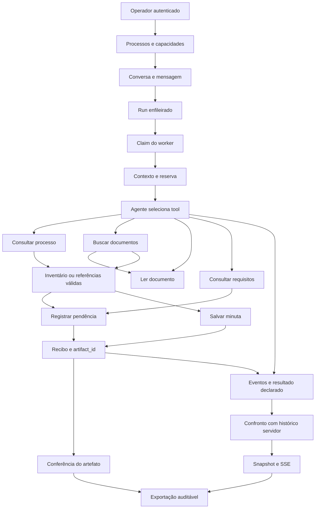

# Plano vigente de melhorias — Backend & Tools

Data: 29/10/2026. Execução sequencial, com liberação do responsável por bloco.

**Situação atual — 30/10/2026:** A0–A13 implementados e verificados localmente. Fechamento A: 390 testes SQLite aprovados em 1.328,12 s, após os aceites dirigidos. Ver [relatório consolidado A](../04-operacoes/validacao-a-fechamento.md). PostgreSQL e revisão manual pendentes; integrações I ainda não iniciadas.

Fontes: [auditoria e seus 13 achados](../04-operacoes/auditoria-backend-2026-10-28.md), [contratos](../../contracts/README.md), [PRD](backend-prd.md), [TDD](backend-tdd.md), [ADRs](../05-decisoes/README.md). O [plano anterior](backend-plano-lacunas-historico-2026-10-25.md) permanece como histórico e não define a ordem vigente.

A sequência vigente passou ao [plano F/A/I/D/E/O/H](backend-plano-blocos.md), fornecido pelo responsável após T6. Este documento preserva o histórico T0–T6 e o mapeamento anterior; a numeração antiga das APIs não define a próxima implementação. F0 foi implementado e verificado localmente em SQLite (231 testes); ver [evidências F0](../04-operacoes/validacao-f0.md). F1 também foi verificado localmente com 50 testes dirigidos; ver [evidências F1](../04-operacoes/validacao-f1.md). F2 foi implementado e verificado com 44 testes dirigidos; ver [evidências F2](../04-operacoes/validacao-f2.md). F3 foi verificado com 40 testes dirigidos; ver [evidências F3](../04-operacoes/validacao-f3.md). F4 foi verificado com 36 testes dirigidos; ver [evidências F4](../04-operacoes/validacao-f4.md). F5 foi implementado e verificado com 57 testes dirigidos; ver [evidências F5](../04-operacoes/validacao-f5.md). F6 e fechamento local do bloco F foram verificados pela suíte completa de 271 testes; ver [matriz e evidências F6](../04-operacoes/validacao-f6.md). A0 foi autorizado pelo pedido explícito do responsável e implementa a fronteira HTTP, verificada pela suíte completa de 283 testes SQLite; ver [evidências A0](../04-operacoes/validacao-a0.md). A1 implementado e verificado com 14 testes dirigidos em SQLite; ver [evidências A1](../04-operacoes/validacao-a1.md). Suíte completa no fechamento A. A2 implementado e verificado por 19 casos dirigidos distintos em SQLite; ver [evidências A2](../04-operacoes/validacao-a2.md). Suíte completa no fechamento A. A3 implementado e verificado com 12 testes dirigidos em SQLite; ver [evidências A3](../04-operacoes/validacao-a3.md). Suíte completa no fechamento A. A4 implementado e verificado com 17 testes dirigidos em SQLite; ver [evidências A4](../04-operacoes/validacao-a4.md). Suíte completa no fechamento A. A5 implementado e verificado por 18 testes dirigidos em SQLite; ver [evidências A5](../04-operacoes/validacao-a5.md). Suíte completa no fechamento A. A6 e A7 implementados e verificados localmente por seleções dirigidas de 6 e 10 testes, respectivamente. Ver [A6](../04-operacoes/validacao-a6.md) e [A7](../04-operacoes/validacao-a7.md). A8 implementado e verificado por 11 testes dirigidos em SQLite; ver [A8](../04-operacoes/validacao-a8.md). PostgreSQL e revisão manual pendentes; suíte completa no fechamento A.

## Governança e situação

Piloto local primeiro, na worktree oficial team/backend. Preservar alterações anteriores. Sem publicação, deploy, commit ou PR por iniciativa própria. Cada bloco termina com diff, contratos, workflow, evidências e pendências; o responsável libera o próximo. A consulta ao Astra é manual e feita pelo responsável, sem agentes ou tarefas automáticas.

Estados distintos: planejado → implementado → verificado → liberado pelo responsável. Não usar resultados históricos como aceite de mudanças futuras.

**Atualização T6 (29/10):** salvar_minuta confere contexto/hash do recibo nos clientes síncrono/assíncrono; ambas as escritas usam o modelo do catálogo na mesma checagem. Escritor comum T5 preservado, sem schema/rota/migração novos. Suíte completa: 219 testes aprovados em SQLite; execução dirigida: 57 aprovados; ver [registro T6](../04-operacoes/validacao-t6.md). PostgreSQL e revisão manual permanecem pendentes; blocos de APIs não iniciados.

**Histórico da atualização T5 (29/10):** registrar_pendencia confere requisito/fontes, efeito e recibo persistidos; cliente confere contexto e hash. WriteReceipt exige UUID/fuso; escritor e fontes continuam compartilhados. Suíte completa: 198 testes aprovados em SQLite; dirigida inicial: 55 aprovados e 2 cenários finais adicionais aprovados. Ver [registro T5](../04-operacoes/validacao-t5.md), incluindo limite de contagem de fases pós-commit no histórico. PostgreSQL e revisão manual permanecem pendentes; T6 não iniciado como bloco.

**Histórico da atualização T4:** consultar_requisitos valida checklist não vazio, IDs únicos, identidade persistida e contexto nos clientes; corrupção gera erro seguro auditado. Suíte completa: 169 testes aprovados em SQLite; execução dirigida: 20 aprovados. Ver [registro T4](../04-operacoes/validacao-t4.md). PostgreSQL e revisão manual permanecem pendentes; T5 e seguintes não iniciados.

**Histórico da atualização T3:** ler_documento confere documento/contexto, páginas exatas em ordem documental e resposta nos clientes; documento inconsistente gera erro seguro auditado. Suíte completa: 158 testes aprovados em SQLite. Ver [registro T3](../04-operacoes/validacao-t3.md). PostgreSQL e revisão manual permanecem pendentes; T4 e seguintes não iniciados.

**Histórico da atualização T1-R:** processo armazenado validado antes do acesso aos campos; payload inválido retorna invalid_response seguro e percorre auditoria após a reserva lógica. 404 para linha ausente e 409 para versão válida divergente preservados. Ver [registro T1-R](../04-operacoes/validacao-t1-r.md). Suíte completa aprovada em SQLite: 145 testes, incluindo regressões T0-R1/T0-R2/T1-R; homologação PostgreSQL e revisão manual continuam pendentes. Não equivale a aceite global da auditoria.

**Histórico da atualização T0-R2:** autorização técnica separada do acesso ao domínio; reserva lógica confirmada antes da consulta ao processo. T0-R1 preservado. Ver [evidências T0-R2](../04-operacoes/validacao-t0-r2.md). PostgreSQL e revisão manual pendentes; T1-R permanece aberto e é a próxima etapa corretiva.

**Histórico da atualização T0-R1:** releitura transacional de worker/proprietário implementada, com travas determinísticas e verificação de perfil/executor/escrita/concessões atuais. Ver [evidências T0-R1](../04-operacoes/validacao-t0-r1.md). Verificação local não equivale a aceite PostgreSQL ou revisão manual; T0-R2 e T1-R continuam abertos.

**Histórico da revisão dirigida, anterior à correção T0-R1:** D0 recebeu correção documental D0-R; T0 continua com duas falhas abertas (autorização atual do worker e reserva anterior ao domínio); T1 continua com falha no payload incompleto do processo. Números de testes abaixo são históricos e não comprovam esses cenários. T2 permanece fora desta correção. A sequência corretiva é D0-R → T0-R1 → T0-R2 → T1-R, com liberação do responsável por etapa.

Histórico de execução — D0: implementado nesta entrega; conferência documental descrita no registro abaixo. T0 implementado e verificado localmente em SQLite, com PostgreSQL e revisão do responsável pendentes; ver [registro T0](../04-operacoes/validacao-t0-2026-10-28.md). T1 implementado e verificado localmente em SQLite (112 testes na suíte completa), com PostgreSQL e revisão manual pendentes; ver [registro T1](../04-operacoes/validacao-t1-2026-10-28.md). T2 implementado e verificado localmente em SQLite (123 testes na suíte completa), com PostgreSQL/Unicode nesse ambiente e revisão manual pendentes; ver [registro T2](../04-operacoes/validacao-t2-2026-10-28.md). T3 e seguintes continuam planejados, aguardando liberação. Nenhum achado de segurança foi encerrado por esta entrega documental.

## T0 — Componentes comuns

Uma implementação compartilhada para catálogo de modelos de entrada/saída, validação no cliente, contexto autenticado, autorização, erros, auditoria e idempotência. Preservar JSON válido e tipos estritos existentes.

| Elemento | Regra |
| --- | --- |
| Contexto | run_id, process_id, corpus_version, requirements_version conferidos pelo servidor; cliente injeta; modelo não escolhe permissões |
| Autorização | Worker/reserva e concessões atuais do worker/proprietário; can_write de ambos nas escritas |
| Chamada lógica | (run_id, tool_call_id) vinculado imutavelmente a ferramenta/hash da entrada |
| Tentativa | Registro separado com duração, HTTP, código, replay e artefato; sem argumentos ou segredos em claro |
| Escrita | (run_id, ferramenta, idempotency_key); artefato e recibo atômicos, relidos após commit |
| Evidência | Chunk/documento/página existentes ou inventário do corpus autorizado |

Reservar identidade lógica de forma durável antes do efeito, sob trava/transação; revalidar autorização na transação do efeito. Mesmo ID/entrada repete a chamada sem nova cobrança. ID reutilizado com outra entrada/tool retorna 409 idempotency_conflict sem efeito. Falhas atribuíveis à reserva ficam registradas; corrigir entrada exige novo ID. Auditoria de falha sobrevive ao rollback. Banco indisponível não permite anunciar confirmação.

Aceite integrado: orçamento 1 recusa duas minutas diferentes com mesmo ID; retry igual recupera o mesmo artefato. Orçamento científico permanece configurável e deve ser explícito no manifesto antes de rodada comparativa.

## Tools — uma por bloco, nesta ordem

| Bloco | Entrada → saída | Mudança específica | Aceite |
| --- | --- | --- | --- |
| T1 consultar_processo | Contexto → ProcessResult | Conferir processo/contexto, inventário sem duplicatas e resposta recebida pelo cliente | Mesmo corpus/versões; cobertura parcial preservada |
| T2 buscar_documentos | Contexto/query/limit → SearchResult | Validar chunks/quantidade/escopo; preservar literal, escape e filtros antes do limite | Vazio 200, banco 503, isolamento e Unicode documentados nos dois bancos |
| T3 ler_documento | Contexto/documento/páginas → DocumentResult | Conferir identidade e páginas solicitadas/devolvidas, ordem e hash do documento completo | Ausente 404; inválido 422; leitura parcial explicitada |
| T4 consultar_requisitos | Contexto → RequirementsResult | Validar IDs únicos e checklist versionado | Checklist correto 200, ausente 404, banco 503 |
| T5 registrar_pendencia | Contexto/requisito/conteúdo/evidências/chave → WriteReceipt | Conferir requisito, fontes, recibo e efeito | Concorrência, rollback, retry após commit e conferência independente |
| T6 salvar_minuta | Contexto/conteúdo/evidências/chave → WriteReceipt | Reutilizar escrita comum, validar recibo/conteúdo/fontes | Hash correto, replay sem duplicação, desvio de orçamento recusado |

Cada tool inclui seu consumidor e documentação no mesmo bloco. Reutilizar validações existentes; não duplicar lógica. Filtros novos, embeddings e metadados adicionais ficam na evolução.

## Fichas completas das ferramentas — correção D0-R

Estas fichas complementam a tabela de sequência. Regras de autenticação, contexto, reserva, orçamento, auditoria e idempotência são referenciadas em [T0 — Componentes comuns](#t0--componentes-comuns), sem criar seis implementações dessas regras. Código e schemas executáveis: [modelos](../../contracts/models.py), [catálogo](../../contracts/catalog.py), [serviço](../../services/backend/tools.py) e [corpus](../../services/backend/corpus.py).

**Pendências transversais de aceite:** T0-R1 implementou a releitura protegida dos dois perfis (verificação local e aceite manual separados); T0-R2 implementou a reserva anterior ao domínio (verificação local e aceite manual separados); T1-R implementou a validação do payload antes de acessar campos, com erro seguro auditado nas tools. D0-R era documental; T0-R1 foi implementado posteriormente, T0-R2 e T1-R foram implementados posteriormente; verificação local e aceite manual/PostgreSQL permanecem separados. A falha anterior de ordem transacional era compartilhada; os resultados locais de T0-R2 não substituem homologação PostgreSQL. Não confundir resultado de testes anteriores com aceite dessas condições.

### Ficha T1 — consultar_processo

- **Situação atual:** implementada, com coerência processo/envelope, inventário único e conferência do contexto pelo cliente. T1-R protege agora o payload incompleto, inclusive requirements_version ausente; aceite PostgreSQL/manual ainda pendente.
- **Entrada e produtor:** POST /tools/consultar_processo recebe ToolContext: run_id UUID e process_id/corpus_version/requirements_version limitados pelo contrato. O cliente comum injeta os valores da execução reservada; o modelo não define permissões. Bearer de worker e X-Run-Token são cabeçalhos técnicos.
- **Saída e invariantes:** ProcessResult contém contexto, Process e inventory de InventoryItem. Processo e versões coincidem com o envelope; document_id do inventário não se repete. Cada item contém título, origem, quantidade de páginas e sha256 do documento completo. Cobertura complete/partial/unknown e nota são preservadas; inventário vazio é permitido.
- **Consumidores e fluxo:** clientes síncrono/assíncrono e adaptador consomem JSON validado. inventory[].document_id pode alimentar ler_documento. Processo/corpus podem fundamentar InventoryEvidence; quantidade de páginas não é lista de números. Inventário parcial ou vazio não comprova ausência no SEI.
- **Sucesso e erros:** 200 inclusive inventário vazio; 401 credencial; 403 contexto/perfil/concessão/reserva; 404 processo autorizado ausente; 409 estado/versão/idempotência/orçamento; 422 entrada. 500 invalid_response também para payload incompleto ou estruturalmente inválido, com auditoria após a reserva lógica (T1-R). 503 storage_unavailable é transitório; não equivale a busca vazia.
- **Componentes e dependências:** T0 compartilhado; Documentos fornece corpus/documentos; Backend mantém leitura e contratos; equipes de agentes revisam consumo. Metodologia interpreta cobertura. Sem runtime real presumido.
- **Mudança entregue em T1-R:** Process validado na fronteira antes do acesso aos campos, 404 para ausência e 409 para versão válida divergente preservados; payload inválido gera 500 seguro e tentativa auditada após reserva. PostgreSQL e revisão manual permanecem pendentes.
- **Aceite e evidências:** repetir a remoção de requirements_version; exigir JSON ToolError, retryable=false, ausência de conteúdo rejeitado, reserva lógica preservada e tentativa HTTP 500. Preservar inventário vazio/404/409 e contexto estrangeiro recusado. [Registro T1](../04-operacoes/validacao-t1-2026-10-28.md) contém evidência histórica, não aceite dessa regressão.
- **Estado:** implementação e correção T1-R locais; evidências atuais no registro corretivo, homologação PostgreSQL e liberação manual pendentes.

### Ficha T2 — buscar_documentos

- **Situação atual:** implementada com filtros de escopo antes do limite, ordem determinística, validação dos chunks contra índice e conferência de contexto/limite pelo cliente. Alterações de T2 estão preservadas e fora da implementação de D0-R.
- **Entrada e produtor:** POST /tools/buscar_documentos recebe SearchInput: contexto comum, query de 1–200 caracteres e limit inteiro estrito de 1–20 (padrão 5). O agente escolhe o termo; cliente injeta contexto/cabeçalhos da reserva.
- **Saída e invariantes:** SearchResult contém contexto, export_completeness, items de Chunk e warning. IDs únicos, no mesmo processo/corpus; no máximo 20 e no máximo o limite pedido. Chunk contém documento, página, origem, texto e offsets compatíveis. Chaves/texto do payload coincidem com a linha consultada. Busca permanece literal, sem ranking ou normalização nova.
- **Consumidores e fluxo:** document_id/page alimentam ler_documento; document_id/chunk_id/page alimentam Evidence e fontes. Texto e origem fundamentam análise; não comprovam interpretação pelo agente. items=[] não é evidência de ausência documental.
- **Sucesso e erros:** 200 inclusive vazio; 401/403 para acesso; 404 para processo/corpus autorizado não localizado; 409 para estado/versão/identidade/orçamento; 422 entrada; 500 invalid_response para índice/saída inconsistente; 503 storage_unavailable para banco, com retry preservando corpo/IDs.
- **Componentes e dependências:** T0, SearchResult, clientes e CorpusRepository; recuperação/ingestão com Documentos. Locale/collation e banco final dependem de Infra; comparabilidade de Metodologia. Filtros novos/embeddings ficam na evolução.
- **Mudança restante:** sem expansão funcional nesta correção; executar regressão por eventual alteração da leitura compartilhada do processo em T1-R.
- **Aceite e evidências:** escopo antes de limite com documentos externos ordenados primeiro, duplicatas/índice corrompido recusados, curingas literais, vazio 200, banco 503 e contexto estrangeiro recusado. [Registro T2](../04-operacoes/validacao-t2-2026-10-28.md) registra SQLite; PostgreSQL/Unicode/locale permanecem pendentes. A revisão dirigida de D0/T0/T1 não revalidou T2.
- **Estado:** implementado e verificado historicamente em SQLite; homologação PostgreSQL e liberação manual pendentes.

### Ficha T3 — ler_documento

- **Situação atual:** rota existente lê documento integral ou subconjunto de páginas no processo/corpus; ReadInput exige páginas positivas/únicas. O reforço T3 foi implementado e verificado localmente; homologação PostgreSQL e liberação manual pendentes.
- **Entrada e produtor:** POST /tools/ler_documento recebe contexto, document_id e pages opcional, lista não vazia de inteiros estritos positivos e únicos. document_id pode vir do inventário; documento/página podem vir da busca. O agente seleciona a leitura e o cliente injeta contexto/cabeçalhos.
- **Saída e invariantes:** DocumentResult contém contexto e Document com ID, processo/corpus, título, origem, sha256 e páginas numeradas com texto. T3 confere identidade do documento, contexto e conjunto exato das páginas pedidas, preservando ordem documental numérica crescente; armazenamento fora de ordem é recusado sem reparo silencioso. Sem pages, devolver o documento inteiro. Hash refere-se ao documento completo, não ao subconjunto retornado.
- **Consumidores e fluxo:** adaptador usa texto/origem/página na análise e resposta; referências completas de chunks continuam vindo da busca. Não criar chunk_id a partir de uma página nem equiparar retorno HTTP a leitura humana.
- **Sucesso e erros:** 200 leitura existente; 404 documento/página ausente no escopo autorizado; 422 páginas/entrada inválidas; 401/403 e conflitos 409 do T0; 503 banco indisponível. 500 invalid_response protege documento/payload/resposta inconsistente; OpenAPI conferido, sem prometer envelope para todos os 500 inesperados/framework.
- **Componentes e dependências:** T0, ReadInput/DocumentResult, CorpusRepository e clientes; Documentos garante páginas/origem e corpus imutável. Revisão de contratos por Backend/Documentos/agentes. Não depende de executar busca antes, se o ID já for conhecido.
- **Mudança entregue em T3:** coerência de documento/envelope/requisição; correspondência exata de páginas, ordem numérica e validação de resposta pelo cliente, reaproveitando T0. Leitura parcial preserva o hash registrado do documento completo.
- **Aceite e evidências:** jornada busca → leitura e inventário → leitura; documento de outro processo recusado; página ausente 404, inválida 422; subconjunto ordenado, integral sem filtro e resposta estrangeira/inconsistente recusada. Registrar HTTP e conteúdo sintético esperado sem logs de documento real. Testes existentes de leitura são referência inicial, não evidência de T3 concluído.
- **Estado:** T3 implementado e verificado localmente (158 testes na suíte completa); [evidências](../04-operacoes/validacao-t3.md), PostgreSQL e liberação manual separados.

### Ficha T4 — consultar_requisitos

- **Situação atual:** rota existente retorna checklist por processo/corpus/requirements_version, com importação administrativa imutável. O reforço T4 foi implementado e verificado localmente em SQLite; PostgreSQL e liberação manual pendentes.
- **Entrada e produtor:** POST /tools/consultar_requisitos recebe somente contexto comum injetado pelo cliente a partir do run reservado.
- **Saída e invariantes:** RequirementsResult contém contexto e items de Requirement: requirement_id, description e source. Todos pertencem ao checklist da versão solicitada. Lista não vazia e IDs únicos; servidor confere payload contra a chave persistida e clientes conferem resposta/contexto da execução. Não introduzir procedimento ou atestado de homologação inexistente.
- **Consumidores e fluxo:** requirement_id alimenta registrar_pendencia; descrição/fonte orientam análise. O agente escolhe qual requisito se aplica. Backend executa e valida, sem decidir sozinho a qualidade metodológica do checklist.
- **Sucesso e erros:** 200 checklist importado; 404 checklist/versão não cadastrado; 401/403 autorização; 409 estado/versão/identidade/orçamento; 422 entrada; 503 falha do banco. 500 invalid_response seguro e auditado para payload/identidade inconsistentes; ausência não é sucesso vazio nem banco indisponível.
- **Componentes e dependências:** T0, RequirementsResult, tabela requirements e importação administrativa. Metodologia homologa conteúdo; Backend mantém contrato; Documentos fornece contexto documental; agentes revisam consumo.
- **Mudança entregue em T4:** IDs únicos, checklist não vazio, coerência de versão/contexto e resposta validada no cliente, mantendo importação imutável e 404 quando ausente. OpenAPI explicita minItems=1; sem campo ou migração nova.
- **Aceite e evidências:** checklist correto 200; ausente 404; banco 503; contexto estrangeiro 403; IDs repetidos e payload corrompido recusados com 500 seguro auditado. Jornada checklist → pendência → GET de artefato/recibo e isolamento dos três campos de escopo em testes HTTP integrados. Fixture/hash e comandos no [registro T4](../04-operacoes/validacao-t4.md); testes não equivalem a aceite de Metodologia.
- **Estado:** T4 implementado e verificado localmente (169 testes na suíte completa, 20 dirigidos); homologação PostgreSQL e liberação manual separadas.

### Ficha T5 — registrar_pendencia

- **Situação atual:** escrita existente com transação, requisito versionado, evidências e recibo idempotente. T0-R1 corrigiu localmente o uso de can_write antigo do worker entre reserva e efeito; PostgreSQL e liberação manual permanecem pendentes; T0-R2 também foi corrigido localmente; aceite PostgreSQL/manual ainda pendente. Reforço específico T5 implementado e verificado localmente em SQLite; revisão manual/PostgreSQL pendentes.
- **Entrada e produtor:** POST /tools/registrar_pendencia recebe PendencyInput: contexto, requirement_id, idempotency_key, content, evidence não vazia e evidence_note. Conteúdo/nota seguem Text (1–100.000 caracteres); IDs seguem Identifier. Requisito vem do checklist; referências vêm de chunks da busca ou inventário autorizado. O agente produz conteúdo fundamentado; cliente injeta contexto/cabeçalhos e ID lógico.
- **Saída e invariantes:** WriteReceipt contém contexto, artifact_id UUID, persisted_at com fuso, content_sha256 e replayed. Payload canônico, chaves, hashes, contexto e identidade do artefato/recibo são conferidos no escritor comum antes de confirmação/replay e na releitura pós-commit. Artefato/recibo confirmados atomicamente; mesma chave/entrada recupera o original, outra entrada conflita. Requisito pertence ao checklist e evidências existem no corpus. Exigir autorização atual de ambos os perfis na transação do efeito, após T0-R1.
- **Consumidores e fluxo:** artifact_id alimenta GET /artifacts/{id} para conferência do operador e declaração experimental; hash permite conferir conteúdo persistido. T5 não é pré-requisito de salvar_minuta. Existência de evidência não comprova sustentação semântica.
- **Sucesso e erros:** 200 gravação ou replay; 401/403 acesso/escrita; 404 processo autorizado ausente; 409 estado, versão, orçamento, ID reutilizado ou chave/conteúdo divergentes; 422 requisito/evidência/entrada inválidos; 503 banco indisponível. 500 invalid_response seguro para requisito, fonte ou artefato/recibo armazenados inconsistentes. Sem recibo fictício em falha; após commit, erro de confirmação pode deixar efeito existente, recuperável com os mesmos IDs/corpo.
- **Componentes e dependências:** T0 corrigido, escritor transacional comum, PendencyInput/WriteReceipt, requirements/artifacts e clientes; Documentos fornece evidências e Metodologia o checklist. A7 validará posteriormente a declaração contra histórico; recibo não equivale a sucesso científico.
- **Mudança entregue em T5:** requisito e chunk armazenados validados, payload/recibo/contexto/efeito conferidos pelo escritor comum, cliente de pendência confere contexto/hash. UUID/fuso no recibo e 500 no resultado do worker são impactos compartilhados documentados. Sem novo escritor, rota, migração ou política de raciocínio.
- **Aceite e evidências:** jornada checklist/busca → pendência → GET independente com conteúdo/hash; entradas/fontes inválidas não persistem; corrupção gera 500 seguro auditado; concorrência/replay deixam um artefato; rollback e falha de confirmação pós-commit cobertos. Perda de resposta recuperada nos clientes síncrono/assíncrono e regressões T0-R1 de revogação executadas. [Registro T5](../04-operacoes/validacao-t5.md) contém comandos/resultados e a limitação do histórico: falha pós-commit pode gerar registros separados para efeito e confirmação na mesma requisição. PostgreSQL/manual continuam pendentes.
- **Estado:** T5 implementado e verificado localmente (198 testes na suíte completa; 55 dirigidos iniciais e 2 cenários finais adicionais). Homologação PostgreSQL e liberação manual separadas.

### Ficha T6 — salvar_minuta

- **Situação atual:** escrita existente com evidências, transação, hash e replay. Recebe a correção compartilhada de autorização T0-R1; a ordem reserva/domínio foi corrigida em T0-R2, com homologação PostgreSQL/manual pendente. T5 reforçou escritor, validação comum de fontes e schema WriteReceipt; esses efeitos compartilhados estão documentados no registro T5. Reforço específico T6 implementado e verificado localmente em SQLite; PostgreSQL e revisão manual pendentes.
- **Entrada e produtor:** POST /tools/salvar_minuta recebe WriteInput: contexto, idempotency_key, content, evidence não vazia e evidence_note, com limites do contrato. Agente produz minuta/nota; busca/inventário fornecem referências; cliente injeta contexto, reserva e chamada lógica. Não recebe requirement_id obrigatório.
- **Saída e invariantes:** WriteReceipt confirmado com artefato, contexto, data, hash e replay. Mesma operação não duplica o efeito; chave com entrada diferente conflita. Reserva lógica é identidade distinta da idempotência da escrita. Sem autorização atual de worker/proprietário, não pode gravar. Cliente T6 confere também contexto completo e content_sha256 contra WriteInput do catálogo; resposta inconsistente é erro definitivo sem retry.
- **Consumidores e fluxo:** artefato é conferido pelo operador; ID/hash seguem para declaração experimental e exportação. Não há nova tool de leitura de artefatos nem dependência obrigatória de uma pendência anterior. Persistência não certifica qualidade da minuta.
- **Sucesso e erros:** 200 gravação/replay; 401/403 credencial ou escrita não autorizada; 404 processo autorizado ausente; conflitos 409 de estado/versão/orçamento/ID/chave; 422 evidências ou entrada inválidas; 503 banco indisponível. 500 invalid_response seguro protege fonte/artefato/recibo inconsistentes pelo escritor comum T5; a verificação T6 exercita essa distinção de 503. Após commit, falha de confirmação pode deixar efeito existente, recuperável com mesmos IDs/corpo.
- **Componentes e dependências:** T0 corrigido e escritor comum exercitado em T5; WriteInput/WriteReceipt, artifacts e clientes; Documentos garante referências e Metodologia avalia qualidade. Homologação dos adaptadores reais permanece externa.
- **Mudança entregue em T6:** cliente confere contexto e hash de salvar_minuta, com validação comum das duas escritas pelo catálogo; sem mudança no escritor. Workflow busca/leitura → minuta → GET independente, orçamento, fontes, rollback, replay e corrupção exercitados em testes HTTP. Sem nova rota, schema, dependência ou migração.
- **Aceite e evidências:** duas entradas com mesmo ID lógico são recusadas; retry idêntico recupera recibo; orçamento 1 não admite segundo efeito; revogação na janela reserva/efeito impede gravação; concorrência, rollback e perda de resposta após commit preservam integridade. Conferir um único artefato, hash, replay e todas as tentativas. Regressões T0-R1/R2 e perda de resposta nos dois clientes compõem a validação dirigida atual. [Registro T6](../04-operacoes/validacao-t6.md) separa resultados locais, homologação e a limitação de contagem de fases pós-commit no histórico.
- **Estado:** T6 implementado e verificado localmente (219 testes na suíte completa; 57 dirigidos). Homologação PostgreSQL e revisão manual pendentes.

## Workflow e transferências

O agente escolhe as tools; as setas são dependências de dados, não roteiro obrigatório de raciocínio.

| Produtor | Saída consumida | Destino |
| --- | --- | --- |
| GET processos | Processo/corpus/requisitos | Conversa ou run, preservando versões |
| Criação de conversa | conversation_id | Mensagem e recuperação da conversa |
| Mensagem ou POST runs | run_id | Claim, snapshot e SSE |
| Claim | Contexto, histórico, tarefa, run_token | Worker/cliente; credenciais ficam fora do modelo |
| consultar_processo | Inventário/cobertura | Escolha documental e InventoryEvidence |
| buscar_documentos | document_id/page | ler_documento |
| buscar_documentos | document_id/chunk_id/page | Evidence das escritas/fontes finais |
| ler_documento | Páginas/texto/origem | Fundamentação; não fabrica chunk_id nem prova compreensão |
| consultar_requisitos | requirement_id | registrar_pendencia |
| Escritas | artifact_id/hash/contexto | GET artifacts e declaração experimental |
| Histórico servidor | Chamadas/tentativas reais | Validação do resultado/exportação |
| Eventos persistidos | Sequência/cursor | SSE e retomada |
| Resultado bem-sucedido | Mensagem final | Memória da próxima pergunta da conversa |

Pendência não é pré-requisito de minuta. Busca vazia não comprova ausência no processo original. Recibo comprova persistência, não qualidade semântica. Falhas/parciais não entram na memória seguinte. Consulta de conteúdo dos artefatos é do operador; não criar implicitamente nova tool.

## APIs — depois das tools, sequencialmente

| Bloco | Superfície | Mudanças e aceite |
| --- | --- | --- |
| A0 | HTTP e proxy | Envelope seguro para domínio/framework/proxy; 401 com WWW-Authenticate, 405 com Allow, no-store autenticado e corpo limitado antes de materializar |
| A1 | Credenciais | Bootstrap somente cria ausentes; alteração administrativa explícita; rotação preserva concessões; reinício não desfaz revogação; auditoria sem segredos |
| A2 | GET health | 200 banco acessível/503 banco indisponível; não anuncia saúde de LLM/worker |
| A3 | GET capabilities | Separar habilitado de worker observado; preservar available como configuração e acrescentar conexão/última observação |
| A4 | Processos/conversas/mensagens | Preservar propriedade, versões, atomicidade, uma execução ativa e memória concluída; limite para novas entradas após verificar replay |
| A5 | Claim/heartbeat | Presença em polling/heartbeat autenticado, reserva exclusiva, 204 sem corpo, expiração de fila |
| A6 | Eventos/SSE/snapshot | Payloads discriminados, quotas, persistência antes da transmissão, retomada sem perdas; stream_error após HTTP 200 |
| A7 | Resultado | Conferir chamadas e artefatos contra servidor; recusar IDs inventados/outro run; preservar replay e consistência com deltas |
| A8 | Artefatos | Conferir tool/payload/recibo/contexto/hash; pendência exige payload de pendência |
| A9 | Exportação administrativa | Histórico servidor completo, erros/replays/pós-término; declaração e evidência separadas; conteúdo opt-in |

Worker observado: claim/polling ou heartbeat compatível há no máximo 60 s, configurável. Isso não comprova conexão à LLM, que permanece desconhecida até homologação. Fila expira em 300 s configuráveis, com timed_out, causa específica e evento terminal.

Tetos iniciais configuráveis: corpo 1 MiB na API/proxy; 20 runs enfileirados por operador; 5 SSE por operador com reservas no banco e expiração; 20.000 eventos/run reservando espaço de encerramento; 1.000 tentativas de tool/run. Limites permanentes encerram com causa explícita sem retry infinito. Tetos operacionais não substituem orçamento científico.

| HTTP | Significado/código |
| --- | --- |
| 200/201/202/204 | Operação concluída/conversa criada/run enfileirado/claim vazio |
| 401/403/404 | unauthorized com desafio Bearer/forbidden/not_found inclusive outro dono |
| 405/413 | method_not_allowed com Allow/payload_too_large |
| 409 | Conflito de estado, idempotência, versão ou orçamento |
| 422 | Validação, contexto ou declaração experimental inconsistente |
| 429 | resource_limit temporário; Retry-After quando aplicável |
| 500/503 | internal_error seguro/banco ou executor indisponível, retry explícito |

Preservar diferença entre reserva inválida/expirada e validação antes da autenticação. Novos campos/códigos compõem v0.4; preservar ExperimentRun v0.1 e estados existentes, acrescentando causas de fila/limites. Regenerar OpenAPI e atualizar consumidor por bloco. Não remover not_implemented só por estar sem uso.

## Dependências, operação e consolidação

- S1 Python: atualizar deliberadamente certifi/OpenTelemetry para releases corrigidas, revisar lock e reconstruir imagens; auditoria repetida como evidência.
- S2 Portal: proposta de alvo exato de lock e compatibilidade para revisão antes da migração Next/dependências. Bloco isolado, sem audit fix --force; jornada completa depois da atualização.
- S3 Banco/operação: migrações aditivas após 0004, backup e aplicação administrativa explícita; restauração de todas as tabelas/vínculos/hashes, incluindo chamadas e tentativas.
- D1 Documentação final: conciliar API, contratos, TDD, ADRs e instruções antigas; distinguir implementado, demonstrado e homologado.

Sem exposição compartilhada enquanto os blocos críticos estiverem pendentes.

## Cobertura dos 13 achados

| Achado | Blocos |
| --- | --- |
| 01 Next | S2 |
| 02 certifi | S1 |
| 03 orçamento | T0/T5/T6 |
| 04 declaração sem comprovação | A7/A9 |
| 05 bootstrap | A1 |
| 06 recursos | A0/A4/A5/A6 |
| 07 conexão | A3/A5 |
| 08 identidade/ciclo | A1 no piloto; identidade individual na evolução remota |
| 09 OpenTelemetry | S1 |
| 10 erros/cache | A0/A6 |
| 11 desafio 401 | A0 |
| 12 tipos | T0–T6/A6–A8/S2 |
| 13 documentos/evidências | D0/S3/D1 |

## Evidências e revisão manual

Não limitar aceite a testes unitários: prever comportamento HTTP integrado, permissões/revogação, concorrência, rollback, timeout pós-commit, conferência independente, worker ausente, retomada SSE, declaração inventada, SQLite/PostgreSQL 17, reinício/migração/restauração e jornada do portal. Preservar checks existentes. Registros de 82 testes da auditoria são históricos.

Pacote por bloco: objetivo/achados, diff, contratos antes/depois, consumidores, workflow, cenários/comandos/resultados, limitações, migração/recuperação e status dos achados. Responsável consulta Astra e libera próximo bloco manualmente; verificação não equivale a revisão CTO.

Evolução separada: filtros, metadados, checklist por procedimento, runner benchmark, adaptadores reais e identidade remota. Exigem especificações/entregas externas; não ampliar correções silenciosamente.

## Registro da entrega D0

Escopo alterado: documentação de backend. Plano anterior preservado integralmente em arquivo histórico; auditoria original preservada. Verificação: validador de links/invariantes e diff de documentação. Não executar testes funcionais, migrações ou aplicações neste bloco, pois não houve alteração de comportamento. T0 depende da próxima liberação do responsável.

## Registro da correção documental D0-R

Implementação documental: seis fichas completas, contendo situação, produtores/consumidores, entrada/saída, invariantes, códigos, dependências, mudanças e evidências de aceite. Fichas distinguem estado atual de comportamento planejado e identificam as falhas abertas de T0/T1. Histórico anterior e auditoria original preservados. Registro de conferência em [D0-R](../04-operacoes/validacao-d0-r.md). Nenhuma correção de implementação foi realizada nesta etapa; T0-R1 aguarda liberação.

## Registro da correção T0-R1

Perfis atuais relidos sob travas na transação de escrita, sem usar o can_write do actor antigo. Fluxo, cenários e limitações em [T0-R1](../04-operacoes/validacao-t0-r1.md). A ordem anterior de consulta ao domínio não mudou; T0-R2 é a próxima etapa, mediante liberação do responsável.

## Registro da correção T0-R2

Autorização técnica sem consulta ao domínio na fase de reserva; validação de processo somente depois do commit lógico, com revalidação de autorização no efeito. Cenários, orçamento e recuperação em [T0-R2](../04-operacoes/validacao-t0-r2.md). T1-R é a próxima etapa mediante liberação; a falha do payload incompleto ainda não foi corrigida.

## Registro da correção T1-R

Validação integral do processo antes de acessar campos, distinção entre linha ausente e JSON null, identidade de processo/corpus conferida e erro ToolFailure seguro. Evidências de auditoria, recuperação e fechamento dos checks em [T1-R](../04-operacoes/validacao-t1-r.md). Implementação não equivale a revisão CTO ou homologação PostgreSQL; T3 depende de liberação específica.

## Registro T3

Validação do documento antes da seleção de páginas, identidade contra a chave autorizada, envelope e páginas conferidos no servidor/clientes. Cenários e limitações em [T3](../04-operacoes/validacao-t3.md). Sem migração ou campo novo de API; T4 depende de liberação específica.

## Registro T4

Checklist validado no escopo versionado, identidade conferida contra a chave persistida e resposta/contexto conferidos nos clientes. Ausente 404, inconsistência 500 segura auditada e banco 503 preservados. Jornada até pendência/artefato e limitações em [T4](../04-operacoes/validacao-t4.md). Sem migração, rota ou campo novo de API; T5 depende de solicitação específica.

## Registro T5

Requisito/fontes, payload canônico, chaves, hashes, efeito e recibo validados no escritor comum; cliente de pendência confere contexto e hash. Workflow completo, contratos, impactos compartilhados, concorrência, rollback e recuperação pós-commit em [T5](../04-operacoes/validacao-t5.md). Sem migração ou rota nova. Limite da instrumentação pós-commit explicitado para revisão; T6 depende de solicitação específica.

## Registro T6

Contexto/hash de salvar_minuta conferidos nos dois clientes; mesma checagem das escritas usa o catálogo. Escritor comum T5 preservado. Workflow, códigos, conferência independente, orçamento, revogação, concorrência, rollback e recuperação em [T6](../04-operacoes/validacao-t6.md). Sem nova rota, schema ou migração. Implementação/verificação local não equivale a aceite global; APIs e dependências aguardam liberação específica.
