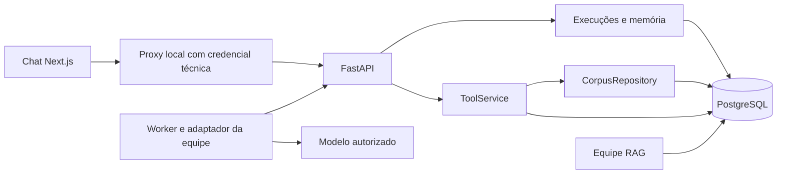

# TDD — Backend, tools e chat

Data: 24/10/2026. Technical Design Document do [PRD](backend-prd.md).
Estado: desenho implementado localmente; integração real depende das equipes.

## Componentes e fluxo

Python 3.12, uv.lock, FastAPI/Pydantic, SQLAlchemy 2, Alembic e PostgreSQL 17.
SQLite serve à prévia e a testes rápidos; não substitui PostgreSQL.
O portal utiliza a versão Next.js 14 resolvida em seu lock; não atualizar framework
incidentalmente. Sem Redis, broker ou serviço RAG HTTP novo.

## Tools primeiro

`ToolService.call(nome, ator, entrada, reserva)` centraliza as seis operações.
Rotas FastAPI apenas recebem modelos, autenticam o ator e despacham para o serviço.
O contexto é validado antes de consultar o corpus ou escrever.

`CorpusRepository` recebe a conexão da transação e fornece processo, inventário,
busca, leitura e resolução de referências. É a fronteira de substituição para
Documentos/RAG. A implementação atual consulta o schema existente, com busca
literal, limite de 20, ordem determinística e escape de curingas. A qualidade da
recuperação e a ingestão permanecem com RAG.

Checklists são registros imutáveis por processo/corpus/versão. Pendências exigem
um requisito existente. Evidências apontam a chunk/documento/página, ou a inventário
do processo quando a limitação é documental. Validar existência não prova
sustentação semântica; essa revisão é metodológica.

Artefato e recibo são gravados atomicamente. A constraint
`(run_id, tool, idempotency_key)` e a trava da execução serializam as escritas.
Replay com entrada igual devolve o recibo; entrada diferente gera 409.
O recibo contém hash SHA-256 e é relido após commit. Timeout de transporte não
autoriza usar chave nova. Após encerramento da execução, consultar o artefato
como operador; não abrir novamente a execução para repetir efeitos.

## Contratos HTTP e catálogo

Fonte: [contratos](../../contracts/README.md) e OpenAPI da aplicação, exportado em
[`services/backend/openapi.yaml`](../../services/backend/openapi.yaml) e resumido na
[referência da API](backend-api.md).
Lacunas frente ao guia e ordem de execução: [plano](backend-plano-lacunas.md).
As seis tools usam `POST /tools/{nome}`. Os modelos de entrada/saída e erros
são compartilhados com os consumidores. `contracts.catalog.tool_catalog()`
exporta nome, descrição e JSON Schema de argumentos sem os campos de ToolContext.
O cliente HTTP injeta o contexto e rejeita divergências; não envia credenciais ao LLM.

Conversas: POST/GET da coleção, GET por ID e POST de mensagem. Execuções:
POST/GET, claim, heartbeat, eventos e resultado. Artefatos: GET por ID.
Respostas têm modelos Pydantic explícitos, incluindo inventário, snapshot de run,
mensagens, capacidades e artefatos. O snapshot inclui IDs dos artefatos para
conferência no chat.

`ConversationInput.participant_id` é UUID opcional. GET de conversas aceita
filtro opcional por participante; o filtro não concede acesso. Conversas anteriores
à migração preservam null, sem inventar atribuição.

## Persistência e migrações

Corpus: processes/documents/chunks. Aplicação: principals/process_permissions,
requirements, conversations/messages, runs/run_events, artifacts.
Runs mantêm snapshot do histórico e resultado; eventos têm sequência única por run
e ID idempotente; artefatos guardam conteúdo, evidências e recibo.

Revisões 0001/0002 preservadas. 0003 acrescenta participant_id nullable e índice
em conversations, sem reescrever mensagens ou corpus. A adoção de banco legado
exige comparação de schema e chave primária. Migrações PostgreSQL usam trava
administrativa para evitar atualização concorrente.

Backup completo antes de atualizar um banco com dados. Downgrade é destrutivo
para os campos/tabelas removidos; rollback com preservação exige restauração em
banco separado e versão correspondente da aplicação.

## Execução, memória e streaming

Mensagem e run são criados atomicamente. Um run ativo por conversa; repetição da
mesma chave/entrada recupera o run. Conversas fixam processo, corpus, requisitos
e executor. A memória contém mensagens de runs concluídos com sucesso, em ordem,
mais a tarefa atual. O marcador de participante não entra no snapshot do agente.

Limite inicial: 100.000 caracteres de contexto; erro context_limit sem truncamento
ou resumo automático. O adaptador deve respeitar adicionalmente o limite real
de tokens do modelo. Benchmark não recebe memória do chat.

Estados: queued/running/succeeded/failed/timed_out. Claim transacional;
reserva padrão 60 s, heartbeat 15 s, orçamento 300 s. Expiração preserva parciais,
impede novas tools e não reexecuta efeitos. Execução e conexão do navegador
têm vidas independentes.

Worker publica status/text_delta com UUID idempotente e termina com AgentResult.
Servidor confirma antes de transmitir SSE: status/text_delta/tool/done.
Reconexão usa snapshot consistente de texto/cursor e eventos posteriores.
Resposta final bem-sucedida coincide exatamente com os deltas; sem suporte a
streaming, adaptador pode fornecer apenas resposta final.

## Identidade, exportação e operação

Navegador mantém UUID pseudônimo e última conversa em localStorage. O proxy
mantém token do operador no servidor, limita rotas, origem e hosts locais.
Workers usam identidade técnica própria e token temporário da reserva.
Permissões atuais de worker e proprietário são verificadas em cada operação.
Participantes do mesmo operador técnico não constituem usuários isolados.

Exportação administrativa `scripts.export_chat`: uma linha JSON por run de chat,
com filtros opcionais de participante/conversa. Sem prompts, respostas ou conteúdo
de artefatos por padrão. Campos de consumo ausentes ficam null; conteúdo privado
exige --include-content. Nunca exporta hashes de credenciais ou tokens de reserva.
O destino não é sobrescrito; falha pode deixar arquivo parcial, informado como tal.
No PostgreSQL, a exportação usa snapshot REPEATABLE READ.

Logs operacionais não contêm documentos, prompts ou segredos. Recibos de tools
e registros declarados pelo agente permanecem distinguíveis de avaliação independente.

## Integração real e verificação

Worker aceita executor e fábrica local modulo:funcao, fornecida pela equipe.
A fábrica retorna AgentAdapter; simulação não pode ser rotulada Hermes/LangGraph.
Não há importação implícita de um pacote homônimo nem API Hermes presumida.
Ver [handoff de integração](../04-operacoes/integracao-agentes.md).

Testes cobrem as invariantes B01–B09 do PRD: filtros, autorização, páginas,
checklists, idempotência, rollback, concorrência, memória, eventos, migrações,
marcador e exportação. Validar PostgreSQL, restart e restauração separadamente.
Portal: lint, TypeScript, build e jornada de envio/reconexão/artefatos.
B10 exige homologação individual de cada adaptador real; testes sintéticos do
worker comprovam somente o protocolo, não comportamento dos agentes.
