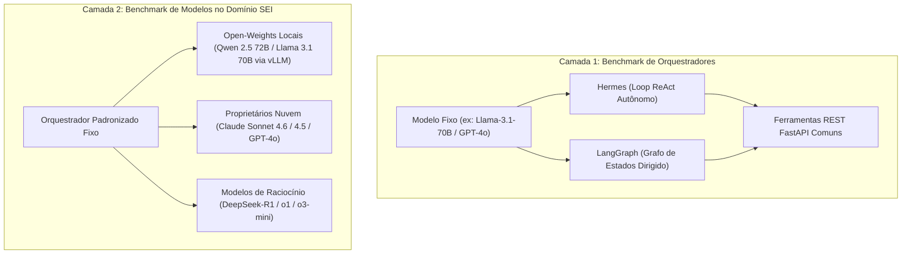
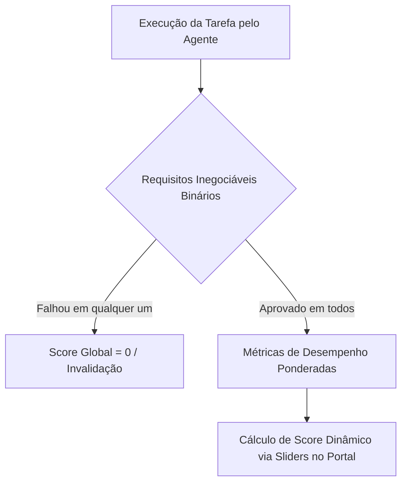

# Proposta Metodológica: Benchmark em Duas Camadas

> **Status:** Proposta para Revisão da Coordenação  
> **Data:** Outubro de 2026  
> **Autores/Origem:** Relatório Técnico de Proposta (CIIA-DF / NIAUnDF)  
> **Frentes Afetadas:** Metodologia, Hermes, LangGraph, Backend, Infraestrutura  

---

## 1. Sumário Executivo e Motivação

A avaliação de sistemas baseados em inteligência artificial para o setor público — especificamente no apoio à gestão e análise de processos administrativos do **Sistema Eletrônico de Informações (SEI)** — enfrenta um desafio metodológico crítico: a frequente **sobreposição entre a eficiência dos frameworks de orquestração de agentes e a capacidade intrínseca de raciocínio dos modelos de linguagem (LLMs)**.

Nos testes empíricos simplificados, quando um agente falha ao responder sobre um documento ou instruir uma etapa processual, torna-se difícil discernir a raiz do erro:
- **Incapacidade do orquestrador:** loops infinitos de raciocínio, ferramentas chamadas fora de ordem, falha no tratamento de respostas vazias (404/vazio nas buscas) ou saturação da janela de contexto.
- **Limitação da LLM subjacente:** alucinação factual, incapacidade de citar evidências exatas (página e documento) ou perda de atenção em processos volumosos.

Para solucionar esse impasse e fornecer resultados com alto rigor acadêmico e aplicabilidade governamental, propõe-se uma arquitetura de **Benchmark em Duas Camadas Independentes**, combinada a uma estratégia de **caching multinível** e **avaliação dinâmica ponderada**.

---

## 2. Camada 1: Benchmark de Orquestradores (Hermes vs. LangGraph)

O objetivo primário da Camada 1 é avaliar o **comportamento algorítmico, a robustez e o overhead introduzido pelo framework de agente em si**. Todas as demais variáveis experimentais são mantidas rigorosamente idênticas.

| Dimensão de Controle | Hermes Agent | LangGraph |
| :--- | :--- | :--- |
| **Modelo Subjacente** | Fixado (ex: Llama-3.1-70B ou GPT-4o) | Idêntico ao Hermes (mesma semente, temperatura e endpoint) |
| **Conjunto de Ferramentas** | Ferramentas HTTP FastAPI comuns (`consultar_processo`, `buscar_documentos`, `ler_documento`) | Idêntico via `ToolClient` comum |
| **Mecanismo de Controle** | Loop dinâmico orientado a tool-calling / CLI autônomo | Grafo direcionado de estados (`StateGraph`) com paradas e nós explícitos |
| **Métricas de Eficiência** | Tokens de overhead interno, chamadas redundantes, tempo de ciclo | Overhead do ciclo de grafo, transições de estado, tempo por nó |
| **Resiliência a Erros** | Tolerância a buscas sem resultados (404/itens vazios) e autocorreção | Capacidade de rollback de estado e recuperação condicional |

---

## 3. Camada 2: Benchmark de Modelos de Linguagem (Domínio SEI)

A Camada 2 representa a avaliação de maior impacto prático para o setor público. Fixando-se o orquestrador padronizado, varia-se a família de modelos para responder a uma questão primordial:

> **Pergunta Científica Central:** *Modelos open-weights hospedados localmente são capazes de atingir a precisão e a estrita fundamentação dos modelos proprietários de ponta em processos do SEI?*

Essa comparação é imperativa devido às exigências de **conformidade com a LGPD e soberania de dados do Governo do Distrito Federal (GDF)**, onde o tráfego de autos processuais restritos ou sigilosos para provedores externos de nuvem pública é frequentemente vetado.

| Categoria | Modelos Avaliados | Hospedagem / Rota | Objetivo Metodológico |
| :--- | :--- | :--- | :--- |
| **Open-Weights (Grande)** | Qwen 2.5 72B Instruct / Llama 3.1 70B | Servidor Local com GPU (`vLLM` / `Ollama`) | Aferir se o teto de raciocínio aberto atinge paridade com modelos fechados sem envio de dados externos. |
| **Open-Weights (Médio)** | Qwen 2.5 32B / 14B / Llama 3.1 8B | Instância On-Premises Econômica | Identificar o limiar mínimo de parâmetros viável para tarefas rotineiras de consulta e extração. |
| **Proprietários (Ponta)** | Claude Sonnet 4.6 / 4.5 (`anthropic/claude-sonnet-4.6` ou `claude-sonnet-4.5`) / GPT-4o | API em Nuvem OpenRouter (HTTPS Criptografado, $3,00 / $15,00 por milhão) | Estabelecer o padrão-ouro (*Gold Standard*) de acurácia em citação de páginas e redação de minutas, substituindo o antigo Sonnet 3.5 pelo mesmo patamar de preço. |
| **Modelos Raciocinadores** | DeepSeek-R1 / o1 / o3-mini | API ou Self-Hosted | Verificar se modelos com Chain-of-Thought (CoT) explícito mitigam o erro de assumir completude em exportações parciais. |

---

## 4. Estratégias de Cache e Otimização para o Agente

Processos administrativos são por natureza extensos (dezenas a centenas de páginas com histórico incremental). A introdução de caching é indispensável para viabilizar custos operacionais sustentáveis e latência aceitável em ambiente de produção:

1. **Prompt Caching / Prefix Caching (Camada de Inferência):**  
   Como cada processo exportado possui integridade garantida por SHA-256 e `corpus_version`, o contexto dos documentos lidos é mantido em cache de prefixo na LLM (suportado nativamente pelo vLLM e APIs modernas). Proporciona até **90% de economia em tokens de entrada** e reduz a latência em até 80% em perguntas sucessivas.
2. **Cache Determinístico de Chamadas de Ferramentas (Tool-Call Caching):**  
   Chamadas de leitura às rotas da API (`consultar_processo` e `ler_documento`) são funções puras sobre uma versão imutável do corpus. Um cache em memória (Redis ou LRU no ASGI) elimina acessos redundantes ao PostgreSQL durante múltiplos passos do agente.
3. **Cache Semântico de Respostas e Pendências (Semantic Caching):**  
   Para consultas rotineiras idênticas ou semanticamente similares feitas por servidores (*"Qual a data de entrega do material?"*, *"Quando expira o prazo?"*), vetores de similaridade evitam reexecutar o ciclo completo do agente para respostas já validadas.

> [!IMPORTANT]
> **Regra Metodológica de Isolamento:** O benchmark deve separar obrigatoriamente:
> - **Rodadas Frias (*Cold-Start Runs*):** Cache desativado para testar estritamente o raciocínio e a busca autônoma;
> - **Rodadas Quentes (*Warm-Start Runs*):** Cache ativado para quantificar o ganho real de throughput, latência e custo.

---

## 5. Rubricas de Avaliação e Ground Truth

Para acomodar diferentes prioridades governamentais, adota-se um **Sistema de Avaliação Dinâmica Ponderada**, estruturado em duas etapas:

### 5.1. Requisitos Inegociáveis (Filtros Binários)
A falha em qualquer um destes critérios invalida a tarefa (nota zero global):
- **Fidelidade Factual (0 ou 1):** A informação extraída confere estritamente com os autos, sem alucinação, distorção ou acréscimo fictício.
- **Citação Precisa de Fonte (0 ou 1):** O agente identificou e citou expressamente o número do documento e o número exato da página onde a evidência reside.
- **Conformidade de Segurança/Acesso (0 ou 1):** O agente respeitou as restrições de escopo e não expôs dados fora de sua permissão.

### 5.2. Métricas de Desempenho Ponderadas (Variáveis Contínuas)
Critérios avaliados continuamente cujos pesos podem ser alterados dinamicamente no portal:
- **Latência de Resposta (segundos):** Tempo total do ciclo de raciocínio e chamadas.
- **Completude da Informação (Score 0 a 100):** Abrangência da resposta frente ao gabarito homologado por especialista.
- **Eficiência de Custos (Tokens Consumidos):** Quantidade de chamadas às ferramentas e volume total de tokens gastos.
- **Conformidade de Escrita/Minuta (Score):** Qualidade da minuta gerada e presença de chave de idempotência válida.
- **Reconhecimento de Exportação Parcial (Score):** Capacidade de identificar que os autos estão incompletos e reportar limitações em vez de assumir premissas falsas.

### 5.3. Análise de Sensibilidade no Portal
A interface do portal contará com sliders interativos para que os gestores ajustem os pesos das métricas (ex.: elevar o peso da Latência de 20% para 60%) e visualizem em tempo real a reordenação dos melhores agentes e modelos para aquele cenário de uso.

---

## 6. Próximos Passos e Entregáveis

- [ ] Ajustar o validador de integridade (`scripts/validate_repository.py`) para acomodar a nova árvore documental e os artefatos do portal.
- [ ] Homologar formalmente na coordenação a versão/tag do motor **Hermes** em `agents/hermes/`.
- [ ] Construir o catálogo de 10 a 20 tarefas representativas em `evaluation/tasks.json` com gabaritos validados por especialista do SEI.
- [ ] Implementar as ferramentas de escrita com idempotência (`POST /tools/registrar_pendencia` e `salvar_minuta`) para substituir os retornos HTTP 501.
- [ ] Desenvolver as visualizações interativas e tabelas comparativas no painel do portal.

---
*Consulte também:* [Protocolo de Avaliação](../../evaluation/protocol.md) · [Catálogo de Tarefas](../../evaluation/tasks.json) · [Arquitetura](architecture.md)
