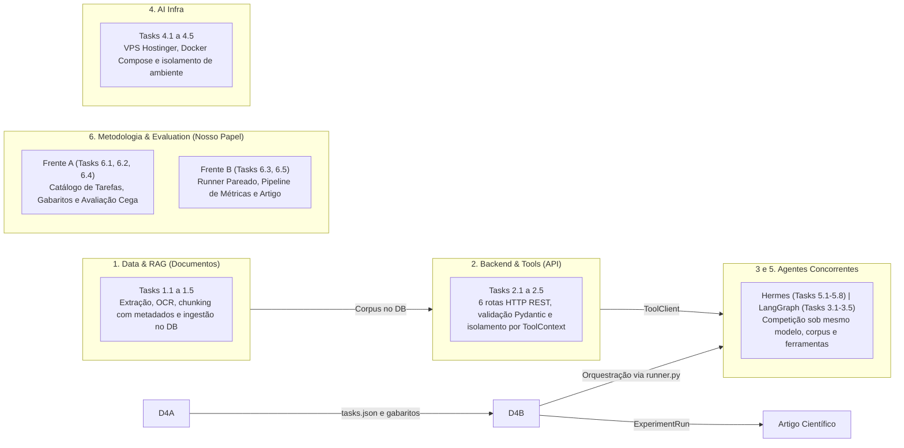

# Guia de Onboarding e Operação — Equipe de Metodologia & Evaluation

**Protocolo Experimental, Benchmark em Duas Fases, Arquitetura de Tasks e Divisão de Trabalho**  
*Centro de Inovação em Inteligência Artificial (CIIA / UnDF) — Outubro / 2026*

| Campo | Detalhe |
| :--- | :--- |
| **Frente:** | Metodologia e Avaliação (Evaluation) |
| **Monitor:** | Gustavo Antônio |
| **Branches Git:** | `feat/evaluation` (ativa) \| `team/metodologia` |
| **Integrantes:** | Nelson Bomfim Neto (3º sem.), Sarah Leticia da Silva (3º sem.), João Pedro Santos (5º sem.), Isaac Joaquim (5º sem.) |
| **Objetivo:** | Protocolo Científico, Harness Pareado & Artigo |
| **Versão em PDF:** | [Guia_Onboarding_Metodologia_Evaluation.pdf](Guia_Onboarding_Metodologia_Evaluation.pdf) |

---

## 1. O Papel do Evaluation e a Estrutura do Benchmark em Duas Fases

A equipe de Metodologia & Evaluation é responsável pelo **rigor científico** de todo o projeto. Nosso papel é formular o desenho experimental pareado, construir o catálogo de tarefas com gabaritos factuais homologados, desenvolver o harness automatizado de medição (`runner.py`) e produzir a análise estatística para o artigo científico.

O benchmark está desenhado em duas fases complementares:

### Fase 1: Benchmark de Arquitetura (Hermes vs. LangGraph) [PRIORIDADE MÁXIMA]
- **Pergunta Científica:** Sob o mesmo modelo e ferramentas, como a orquestração dinâmica do Hermes difere do grafo determinístico do LangGraph?
- **Controle Experimental Estrito:** Modelo de linguagem único fixado (mesma semente/temperatura), mesmo corpus administrativo sintético do SEI e mesmas ferramentas de leitura HTTP do Backend.
- **Volume Previsto:** 60 tarefas × 2 executores × 3 repetições = **360 execuções completas**.
- **Métricas Centrais:** Sucesso Verificado (SR), Acurácia no uso de ferramentas (TUA), latência do orquestrador e passos/turnos de execução.

### Fase 2: Benchmark Expandido Multi-Modelo (Nuvem vs. Locais)
- **Pergunta Científica:** É viável para a administração pública (SEI/GDF/LGPD) adotar modelos abertos/locais (auto-hospedados) em vez de APIs comerciais?
- **Variável Independente:** Comparação de modelos High-End em nuvem (GPT-4o, Claude 3.5) vs. Modelos Locais/Open-Weights (Qwen 2.5, Llama 3.1, Hermes 3).
- **Volume Planejado:** 360 execuções × 3 classes de modelos = **1.080 execuções completas**.
- **Achado do Manuscrito:** Custo por Tarefa Concluída (CTCE) vs. degradação de acurácia, e se a rigidez do LangGraph amortece modelos locais menores.

> [!IMPORTANT]
> **Diretrizes Inegociáveis de Rigor Científico:**
> 1. **Congelamento Prévio (*Freeze*):** Tarefas, rubricas e prompts devem ser congelados antes da coleta oficial. Nunca alterar rubricas após observar execuções.
> 2. **Separação de Splits:** Tarefas de `development` são públicas para desenvolvimento dos agentes. Tarefas de `final` são secretas (sem vazamento de contexto / *data leakage*).
> 3. **Avaliação Cega por Pares:** Respostas e minutas devem ser auditadas por 2 avaliadores independentes sem saber a identidade do executor (Hermes ou LangGraph).
> 4. **Medidas Repetidas:** Repetições da mesma tarefa são observações correlacionadas; requerem análise estatística pareada apropriada (Wilcoxon / t pareado).

---

## 2. Fase 0: Preparação do Ambiente e Smoke Test de Validação

Executar os comandos abaixo no terminal local para sincronizar o workspace da equipe:

```bash
# 1. Alternar para a branch de trabalho e incorporar a main:
git fetch origin && git checkout feat/evaluation && git merge origin/main

# 2. Sincronizar o ambiente virtual isolado (uv / Python 3.12):
uv sync --locked

# 3. Validar integridade dos contratos, modelos e verificações do repositório:
uv run --locked python -m scripts.dev check
```

---

## 3. Divisão Estratégica de Responsabilidades entre os Membros

| Frente / Integrantes | Tasks do Backlog | Atribuições Técnicas e Entregas Concretas |
| :--- | :--- | :--- |
| **Frente A: Tarefas, Gabaritos e Avaliação Cega**<br/>• Nelson Bomfim Neto (3º sem.)<br/>• Sarah Leticia da Silva (3º sem.) | **Task 6.1**<br/>**Task 6.2**<br/>**Task 6.4** | 1. **Construção do Catálogo em `evaluation/tasks.json`:** Expandir o arquivo para 12 a 15 tarefas piloto de leitura (Fase 1) cobrindo busca de termos, prazos de processos, conferência de anexos e identificação de exportação parcial.<br/>2. **Elaboração de Gabaritos e Rubricas Binárias (0/1):** Formular critérios factuais rígidos: citação obrigatória de documento/página física, exatidão da resposta e ausência de alucinações.<br/>3. **Protocolo de Avaliação Cega:** Desenvolver formulário de duplo avaliador cego para notas de qualidade textual de minutas e despachos. |
| **Frente B: Automação, Runner e Estatística**<br/>• João Pedro Santos (5º sem.)<br/>• Isaac Joaquim (5º sem.) | **Task 6.3**<br/>**Task 6.5** | 1. **Harness Automatizado (`evaluation/runner.py`):** Criar script que carrega as tarefas de `tasks.json`, instancia os adaptadores (`HermesAdapter`, `LangGraphAdapter` ou `simulation`), executa chamadas em loop pareado com isolamento por `run_id` (UUID em `ToolContext`) e salva os logs em `ExperimentRun`.<br/>2. **Pipeline de Métricas (`evaluation/metrics.py`):** Implementar o cálculo automático de Taxa de Sucesso (SR), Acurácia de Ferramentas (TUA), Custo (CTCE) e Latência.<br/>3. **Análise Estatística:** Configurar os testes de hipótese pareados (Wilcoxon / t pareado) e intervalos de confiança. |

---

## 4. Arquitetura Geral do Benchmark e Fluxo Integrado das Tasks

O benchmark do SEI é uma esteira de ponta a ponta. A equipe de Evaluation é o **órgão validador e juiz imparcial** do sistema:



---

## 5. Detalhamento Completo das Tasks 6.1 a 6.5

| Task / Responsável | Escopo e Entregas Técnicas | Onde se Encaixa no Projeto |
| :--- | :--- | :--- |
| **Task 6.1 — Catálogo de Tarefas**<br/>*(Frente A: Nelson & Sarah)* | Construir 12 a 15 tarefas piloto em `evaluation/tasks.json` (split `development`) e reservar 40 a 60 tarefas secretas para o split `final`. | Fornece os insumos e perguntas oficiais que os agentes e o backend precisam processar. |
| **Task 6.2 — Gabaritos e Rubricas**<br/>*(Frente A: Nelson & Sarah)* | Homologar critérios factuais rígidos (0/1): citação exata de documento e página física, exatidão da resposta e ausência de alucinações. | Determina a verdade de base (*Ground Truth*) que alimenta o campo `verified_success` do `ExperimentRun`. |
| **Task 6.3 — Pipeline de Métricas**<br/>*(Frente B: João Pedro & Isaac)* | Desenvolver `evaluation/metrics.py` para calcular Taxa de Sucesso (SR), Acurácia de Ferramentas (TUA), Custo (CTCE) e Latência consolidada. | Consome os JSONs salvos em `evaluation/results/` e gera tabelas para o artigo acadêmico. |
| **Task 6.4 — Avaliação Cega de Textos**<br/>*(Frente A: Nelson & Sarah)* | Estruturar metodologia e formulário de duplo avaliador humano cego (sem identificar Hermes ou LangGraph) para auditar qualidade de minutas e despachos. | Garante neutralidade e rigor na avaliação de redação administrativa e fundamentação jurídica. |
| **Task 6.5 — Runner Pareado & Estatística**<br/>*(Frente B: João Pedro & Isaac)* | Criar `evaluation/runner.py` para orquestrar execuções pareadas com isolamento estanque via `ToolContext` (run_id UUID) e rodar testes pareados (Wilcoxon). | É o orquestrador geral do benchmark: conecta os adaptadores de IA às tarefas e grava os logs oficiais. |

---

## 6. Esclarecimento de Arquivos: O que Já Existe vs. O que Deve Ser Criado

> [!NOTE]
> **O modelo DEV-001 NÃO é um arquivo apagado de versões antigas!**  
> `DEV-001` é o identificador (`task_id`) da primeira tarefa sintética que **já existe declarada** dentro de `evaluation/tasks.json`. Ela consulta os arquivos de fixture `examples/process.json` (processo `PROC-DEMO-001`) e `examples/document.json` (documento `DOC-DEMO-001`, pág. 2). O teste automatizado `tests/backend/test_experiment_contract.py` valida ativamente esse vínculo.

| Arquivo no Repositório | Status | Responsável | Papel e Descrição |
| :--- | :--- | :--- | :--- |
| `evaluation/tasks.json` | **Existe** | Frente A | Catálogo formal de tarefas. Contém o template `DEV-001` e deve ser expandido. |
| `examples/process.json`<br/>`examples/document.json` | **Existe** | Documentos | Fixtures sintéticas do SEI ingeridas no banco que comprovam o gabarito de `DEV-001`. |
| `evaluation/protocol.md` | **Existe** | Coordenação | Protocolo experimental mestre: regras de congelamento, sementes e rubricas. |
| `contracts/models.py` | **Existe** | Backend | Modelos Pydantic de `ExperimentRun`, `ToolContext` e `ToolCallRecord`. |
| `evaluation/runner.py` | **A CRIAR** | Frente B | Orquestrador de execução em Python (Passo 2 do plano de ação). |
| `evaluation/metrics.py` | **A CRIAR** | Frente B | Script de cálculo e consolidação estatística (Passo 3 do plano de ação). |
| `evaluation/results/` | **A CRIAR** | Frente B | Diretório local onde os relatórios JSON de `ExperimentRun` serão persistidos. |

---

## 7. Plano de Ação Imediato (Como Destravar esta Semana)

Para destravar a esteira do benchmark sem depender do término dos agentes reais, a equipe deve seguir estas prioridades:

### Passo 1 (Nelson & Sarah) — Criar as Primeiras Tarefas Piloto da Fase 1 em `tasks.json`
Abram `evaluation/tasks.json` e utilizem o modelo `DEV-001` como base. Construam 5 novas tarefas de consulta factual sobre os documentos sintéticos do SEI utilizando apenas as ferramentas ativas (`consultar_processo`, `buscar_documentos`, `ler_documento`):
- **Caso A (Recuperação direta):** Localizar a data de homologação de edital citando explicitamente o documento e a página física.
- **Caso B (Busca vazia):** Perguntar sobre termo inexistente no processo. O agente deve informar a ausência sem alucinar aprovações fictícias.
- **Caso C (Exportação parcial):** Perguntar sobre histórico do processo e exigir que o agente declare expressamente a limitação de completude.

### Passo 2 (João Pedro & Isaac) — Construir o Runner Automatizado (`evaluation/runner.py`)
Desenvolvam o orquestrador de execução em Python. Ele deve:
1. Ler `evaluation/tasks.json` filtrando por split (`split='development'`);
2. Gerar um `run_id` (UUID) e empacotar no objeto `ToolContext`;
3. Chamar dinamicamente o adaptador informado por linha de comando (`--adapter hermes`, `--adapter langgraph` ou `--adapter simulation`);
   > *Dica essencial:* Use `simulation` inicialmente para validar todo o pipeline sem depender do término dos agentes reais!
4. Coletar o retorno `ExperimentRun` e persistir o JSON em diretório de resultados (`evaluation/results/`).

### Passo 3 (João Pedro & Isaac) — Criar o Script de Apuração de Métricas (`evaluation/metrics.py`)
Criem o módulo de cálculo que consome a pasta de resultados JSON e consolida o relatório estatístico com médias, desvio padrão e testes comparativos.

---

## 8. Especificação Formal das Métricas de Benchmark do Artigo

| Métrica | Fórmula / Critério Operacional | Objetivo Científico |
| :--- | :--- | :--- |
| **Taxa de Sucesso Verificado (SR)** | 1 se todos os critérios de aceite do gabarito foram cumpridos e as fontes físicas comprovadas; 0 caso contrário. | Eficácia primária do agente em resolver a tarefa administrativa sem alucinação. |
| **Acurácia de Ferramentas (TUA)** | TUA = Chamadas Válidas / Total de Chamadas. Penaliza chamadas 422, repetições inúteis ou ferramentas fora de escopo. | Avaliar a precisão decisória do orquestrador ao interagir com o backend. |
| **Custo por Tarefa Concluída (CTCE)** | CTCE = Custo Total de Tokens (USD) / Tarefas com Sucesso. Para modelos locais, reportar em tokens totais. | Medir a viabilidade econômica do sistema (essencial na Fase 2: High-End vs. Local). |
| **Latência & Passos** | Tempo total da execução (latency_ms) e contagem de turnos até o encerramento. | Medir overhead de orquestração do LangGraph frente ao loop livre do Hermes. |

---

## 9. Critério de Aceite da Milestone e Cronograma de Entrega

- **Milestone Oficial da Equipe:** Catálogo piloto com 12 a 15 tarefas homologadas, script `evaluation/runner.py` executando chamadas de teste simuladas e módulo `evaluation/metrics.py` gerando tabela consolidada.
- **Cronograma Alinhado:**
  - **Outubro:** Finalização de tarefas piloto, runner pareado, métricas e homologação de rubricas.
  - **Novembro:** Congelamento (*freeze*) de código e prompts; execução pareada das 360 rodadas oficiais (Fase 1).
  - **Dezembro (até 10/12):** Análise estatística final, testes de hipótese (Wilcoxon) e redação dos resultados do artigo científico.

---

## 10. Mapa de Navegação e Arquivos para Consulta

| Arquivo / Caminho | Papel no Repositório |
| :--- | :--- |
| [`evaluation/protocol.md`](../../evaluation/protocol.md) | Protocolo experimental mestre: regras de pareamento, congelamento, sementes e rubricas. |
| [`evaluation/tasks.json`](../../evaluation/tasks.json) | Catálogo formal de tarefas contendo prompts, splits, processos vinculados e critérios de aceite. |
| [`contracts/models.py`](../../contracts/models.py) | Estrutura oficial de `ExperimentRun`, `ToolCallRecord` e `ToolContext`. |
| [`agents/interface.py`](../../agents/interface.py) | Interface padrão do adaptador (`AgentAdapter.run`) e cliente HTTP das ferramentas (`ToolClient`). |
| [`docs/03-equipes/metodologia.md`](metodologia.md) | Diretrizes de equipe, governança científica e responsabilidades individuais. |
| [`docs/01-overview/backlog.md`](../01-overview/backlog.md) | Backlog formal com a descrição e critérios das Tasks 6.1 a 6.5. |
